# Design Document

## Overview

`kiro-mcp-server` is a Node.js 20+ TypeScript MCP stdio server with 32 typed tools and one subscribable transcript resource that orchestrate Kiro CLI V3. It copies the shape of `claude-code-mcp-server`:

- the same `src/` and `test/` layout;
- `@modelcontextprotocol/sdk` and `zod` as the only runtime dependencies;
- strict zod input schemas and an `outputSchema` on every tool;
- one argv builder;
- process-group tracking and cleanup;
- in-memory jobs with a TTL;
- a fake CLI fixture for tests;
- the same CI and trusted-publishing release workflows.

The server drives Kiro through three channels:

1. **ACP host** (primary). One long-lived `kiro-cli acp --agent-engine=v3 --auth-method=cli` child. The server is an ACP client over newline-delimited JSON-RPC 2.0. It multiplexes every attached session over that one connection.
2. **Headless runs.** `kiro-cli chat --v3 --no-interactive --output-format stream-json` children, one per `kiro_run_headless` job. The prompt goes on stdin.
3. **CLI subcommands.** Short-lived, fixed-argv `kiro-cli` calls for features that exist only as commands: `whoami`, `diagnostic`, `doctor --all`, `settings`, `agent`, `mcp`, `powers`, `chat --list-models`.

### Live probe (2026-11-02, kiro-cli 2.37.1, KAS 0.66.70)

The design was checked against the installed CLI. The probe ran in a scratch `/tmp` workspace and deleted every session it created afterwards.

- `initialize` advertises:
  - `loadSession`;
  - `promptCapabilities` `image` and `embeddedContext`;
  - `sessionCapabilities` `list`, `close`, `delete`, and `fork` (with `_meta.kiro.messageId`);
  - `sessionSources` `local` and `remote`;
  - `sessionListScopes` `workspace` and `user`;
  - `executionTargets` `local` and `cloud-sandbox`;
  - `autoCompactionThreshold` 0–80;
  - logging channels;
  - 32 `extensionMethods`: knowledge, memory, code intelligence, session context, compact, export, and history, config template, configuration getState and set, 15 workflow methods, and source providers.
- `session/new` returns:
  - `modes.availableModes`: `vibe`, `spec`, `quick-spec`, `bug-fix`, `plan`, `autonomous`, `semantic_reviewer`, and every custom agent;
  - `configOptions`: `mode`, `model` (22 models including `auto`), `memoryReflection`, `autopilot`, and `contentCollection`.

  `effortLevel` appears only for models that support it.
- These methods are not advertised but work: `_kiro/account/getUsage`, `_kiro/session/rename`, `_session/steer`, and `_kiro/mcp/resetServer`. `_kiro/hooks/list` errors with "not available when v2Hooks is disabled". `_kiro/configuration/getState` requires `observer: "session"` with a `sessionId`.
- Permission request: the options are `accept`/`allow_once`, `always-accept`/`allow_always`, `reject`/`reject_once`, and `always-reject`/`reject_always`. `_meta.kiro` carries `toolId` (for example `run_command`), `command`, `consent` (`capability`, `resource`, `askType`, `triggeringResource`, `workspaceRoot`), and `consentRound`. A rejected call ends as `tool_call_update` with status `failed`.
- Notifications seen without any prompt:
  - `_kiro/mcp/status` (13 full snapshots);
  - `_kiro/tools/didChange`;
  - `_kiro/steering/documents_changed`;
  - `_kiro/progressive_context/items_changed` (skills);
  - `_kiro/powers/items_changed`;
  - `_kiro/governance/state`;
  - `_kiro/sessions/changed`;
  - `_kiro/customAgent/config_error`;
  - `_kiro/memory/syncStatus`;
  - `available_commands_update`, with types `custom-agent`, `skill`, and `prompt`;
  - `config_option_update`;
  - `session_info_update` kinds `context_usage`, `user_message_id_assigned`, `focus_update`, `turn_start`, `pending_interaction`, `interaction_resolved`, `turn_completion` (with `promptTurnSummaries` credits), and `turn_end`.
- Headless stream-json lines are `{ "type": "runStarted" | "sessionUpdate" | "runFinished", "data": ... }`. `sessionUpdate.data` is the ACP `session/update` params. `runFinished.data` has `sessionId`, `status`, `stopReason`, `finalText`, and `finalTextTruncated`. A headless run with the CLI login and no `KIRO_API_KEY` worked.
- `session/list` with `cwd: "/tmp/..."` missed a session whose stored cwd was `/private/tmp/...`, so every `cwd` is sent as a real path (Requirement 4.5).
- `kiro-cli agent list` and `kiro-cli mcp list` print text, not JSON, and show the V2 agent store. V3 agent and MCP state comes from ACP snapshots instead.

### ACP host versus headless

| Concern | ACP host (`acp --agent-engine=v3`) | Headless (`chat --v3 --no-interactive --output-format stream-json`) |
| --- | --- | --- |
| Session lifetime | Long-lived. Many turns, many sessions, MCP servers stay up | One process per run. MCP servers start every time |
| Permissions | Interactive `session/request_permission`, answered by the calling agent within policy | None at run time. Only `--trust-all-tools`, `--trust-tools`, or policy files. Anything else is denied |
| Mid-turn control | `session/cancel`, `_session/steer`, mode and model switches | Only kill the process |
| Discovery | `session/list`, snapshots for MCP, tools, steering, skills, and powers, and config getState | None |
| Extensions | Memory, knowledge, code intelligence, workflows, compact, export, history, usage | None |
| Cloud | `executionTarget` on `session/new`, remote list and load | `--cloud --repo` |
| Startup gates | Not available | `--require-mcp-startup` (exit 3), missing agent (exit 4), `--sandbox` |
| Auth | CLI login (`--auth-method=cli`) | CLI login, or `KIRO_API_KEY` |
| Output | Notifications routed by `sessionId` | JSON Lines of the same ACP payloads plus run envelopes |
| Failure blast radius | One host crash detaches every session. The server re-attaches with `session/load` | Isolated per run |
| Flags | `--agent`, `--model`, `--effort`, and `--trust-*` are rejected | All chat flags allowed |

The ACP host is the primary path because only ACP gives interactive permissions, steering, multi-turn sessions, discovery snapshots, and the extension methods. Full parity depends on all of these. Headless is kept for:

- fire-and-forget and CI-style runs;
- strict startup gates (`--require-mcp-startup`, `--sandbox`);
- operator-approved trust flags;
- `KIRO_API_KEY` machines.

Both paths share one update normalizer, so events look the same.

### Decisions

Decisions 9 to 14 were settled on issue #2 (the decisions comment). The shell question had no reply, so it keeps the recommended default.

| # | Decision | Rationale |
| --- | --- | --- |
| 1 | One shared host, not one per workspace. The host runs with `cwd` set to the first root | ACP sessions each carry their own `cwd`. One host keeps MCP startup cost and memory low. A crash detaches every session, and each is re-attached with `session/load` the next time it is used (Requirement 5.5, 5.6) |
| 2 | Turns settle only from the `session/prompt` response | A `turn_end` info update never settles a turn (ACP migration guide, section 4) |
| 3 | Prompt-then-poll: `kiro_prompt` waits at most `MAX_WAIT_S`, then returns a cursor. `kiro_events` long-polls. Progress notifications are an extra | MCP clients often time out at about 60 s |
| 4 | Commands go through the prompt only when advertised | Kiro removed the generic command API. `/<name>` text is sent only for names in the latest `available_commands_update` (skills, prompts, custom-agent sub-agents). TUI commands map to typed tools |
| 5 | Tangent is composed and held in memory | There is no ACP tangent method. Branch is `session/fork` at the latest message. Merge is one summary prompt in the tangent plus one prompt in the destination |
| 6 | Unadvertised methods are allow-listed in `KNOWN_UNADVERTISED`: `_kiro/account/getUsage`, `_kiro/session/rename`, `_session/steer` | Any other optional method is called only when advertised. Method-not-found always maps to `UNSUPPORTED_BY_KIRO` |
| 7 | Transcript streaming reuses the session event feed. `kiro_stream_session` is a filtered, size-capped, auto-attaching read of it, and the transcript resource is a view of the same feed (Requirement 26) | One buffer and one cursor space for `kiro_events`, the stream tool, and the resource. No second copy of events |
| 8 | Resource update notifications are coalesced per URI with a 250 ms timer | Meets the 1 s target (26.6) without one notification per chunk |
| 9 | Workspace trust: the README tells operators to trust each folder once in `kiro-cli --v3`. `kiro_status` warns when a root is not trusted (2.6) | ACP has no method for trusting a workspace. The check reads `workspaceTrusted` from `~/.kiro/workspace-roots/<first 16 hex of sha256(realpath)>/permissions.yaml`, read-only. That layout is undocumented (it was confirmed on 2.37.1), so a missing file reports `false` and an unreadable or unparsable one reports `null`. The home directory always reports `false`, because Kiro never saves trust for it |
| 10 | No v2 adapter: 0.1.0 is V3 only | The v2 ACP server has a different method catalog (`_kiro.dev/*`) and different permission fields, and Kiro's guide says to keep separate adapters. V2 sessions stay reachable because V3 `session/load` imports them |
| 11 | Hand-written JSON-RPC, no ACP SDK dependency | The framing is about 200 lines, most of the surface is `_kiro/*` extensions an SDK would not type, and it keeps the sibling's two-dependency rule. Revisit the ACP TypeScript SDK if ACP churns |
| 12 | Elicitation: when the client declares the elicitation capability, pending permissions under `ask` are also sent as a form elicitation. Otherwise, and on `cancel` or error, they wait for `kiro_permissions` and `kiro_permission_respond` (12.11) | Lets a person at the client answer directly while keeping polling as the universal path. The enum lists only options the server would accept, so the gates in 12.5 and 12.7 still hold |
| 13 | Login stays human-only. `kiro_status` reports a signed-out CLI and gives the `kiro-cli login` command | Login needs a person in a browser or device flow. The server never relays authorization URLs or codes |
| 14 | Shell approvals stay off by default (`KIRO_MCP_ALLOW_SHELL`), with the opt-in documented in the README and the skill | Same default as `claude-code-mcp-server`. ACP sessions cannot run tests until the operator opts in |
| 15 | Skills live in `skills/` at the repository root and install from GitHub with `npx skills`. They are not in the npm package | `npx skills add <owner>/<repo>` reads the repository. CI installs from the checkout, so the tested path is the published path (Requirement 27) |
| 16 | The SemVer check script is copied from `KaTeX-Agent-Skill/scripts/check-skill-versions.mjs` | It is dependency-free and requires a quoted version, as issue #3 asks |
| 17 | `KIRO_MCP_ELICITATION` (`on` by default, or `off`) switches the elicitation forward off. A `decline` still means reject when forms are on (12.11, 12.12) | Issues #7 and #8: some clients declare form elicitation but decline every form without showing it, so every request was rejected within milliseconds. Making `decline` leave the request pending instead would let the calling agent approve what a person refused. An operator switch keeps both kinds of client safe |
| 18 | Rejections the server made on its own are listed per turn as `auto_rejected`, each with a hint naming the setting (12.13) | The tool-call record already says `denied`, but not why or what to change. Issue #7's reporter could not tell a policy rejection from a client one |
| 19 | The usage guard counts plan, bonus, and add-on credits as one pool and checks only before a tool starts work (3.6). An unreadable reading lets work go ahead | Kiro spends plan credits and then bonus credits, so one percentage is what runs out. Same rule as `claude-code-mcp-server` (its issue #29): a budget guard, not a security control. Steer, cancel, and compact serve work already running. The guard waits at most 10 s for a reading and, after a failure, skips reading for 30 s, so unreadable usage never stalls each call for the 120 s request timeout |

### Requirement coverage

| Requirement | Design element |
| --- | --- |
| 1 Startup, packaging | `src/index.ts`, `src/config.ts`, `src/prereq.ts`, `.github/workflows/ci.yml`, `release.yml` |
| 2 Status, auth, diagnostics | `kiro_status`, `src/cli.ts`, `src/parse.ts` |
| 3 Usage | `kiro_usage`, `Turn.credits`, `src/usage.ts` `UsageReader` (3.5, 3.6) |
| 4 Roots | `src/paths.ts` `Roots.resolveInside` |
| 5 Host | `src/acp/jsonrpc.ts`, `src/acp/host.ts` |
| 6–8 Sessions | `src/sessions.ts`, session tools |
| 9 Prompts | `src/prompt.ts`, `src/turns.ts`, `kiro_prompt` |
| 10 Events | `src/events.ts`, `kiro_events`, `kiro_session_history` |
| 11 Steer and cancel | `src/turns.ts`, `kiro_steer`, `kiro_cancel` |
| 12 Permissions | `src/permissions.ts` |
| 13, 14 Modes and specs | `kiro_session_configure`, `src/specs.ts`, `kiro_specs` |
| 15, 17 Snapshots and context | `AttachedSession.snapshots`, `kiro_session_state`, `kiro_session_compact` |
| 16 Fork and tangent | `kiro_session_fork`, `src/tangent.ts` |
| 18–20 Extensions | `src/tools/extensions.ts` |
| 21 Cloud | `kiro_session_new` cloud target, `kiro_cloud_sources` |
| 22 Headless | `src/headless.ts`, `src/jobs.ts` |
| 23 Config | `src/tools/config.ts`, `src/argv.ts` |
| 24 Process safety | `src/children.ts`, `src/cli.ts` |
| 25 Errors and output | `src/errors.ts`, `SERVER_INSTRUCTIONS` |
| 26 Transcript streaming | `src/tools/stream.ts`, `src/transcript.ts`, `EventFeed` |
| 27 Bundled skills | `skills/kiro-orchestration/`, `scripts/check-skill-versions.mjs`, the `skills` CI job |
| 2.6 Workspace trust | `src/trust.ts` |
| 12.11, 12.12 Elicitation | `src/permissions.ts` `PermissionBroker.elicit`, `Config.elicitation` |
| 12.13 Auto-rejections | `Turn.autoRejected`, `src/server.ts` `wirePermissions` |

## Architecture

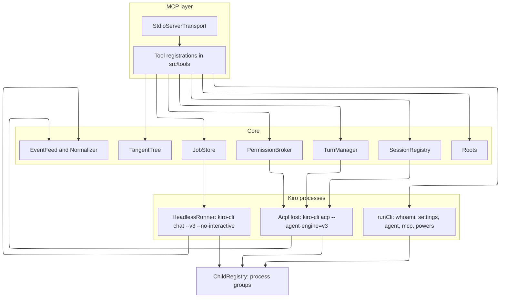

### Prompt, permission, and poll

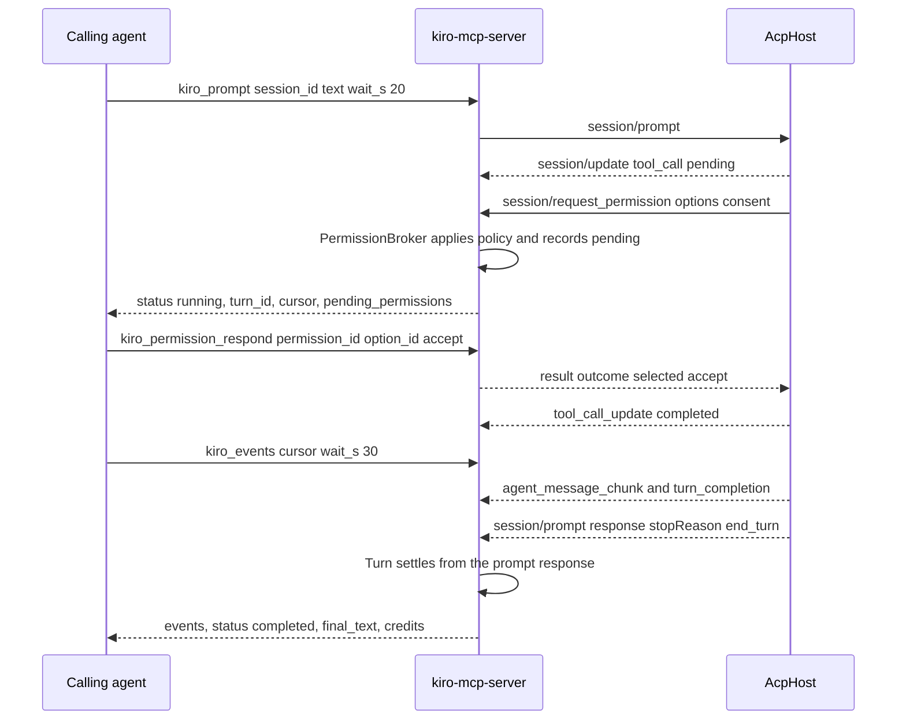

### Host exit and re-attach

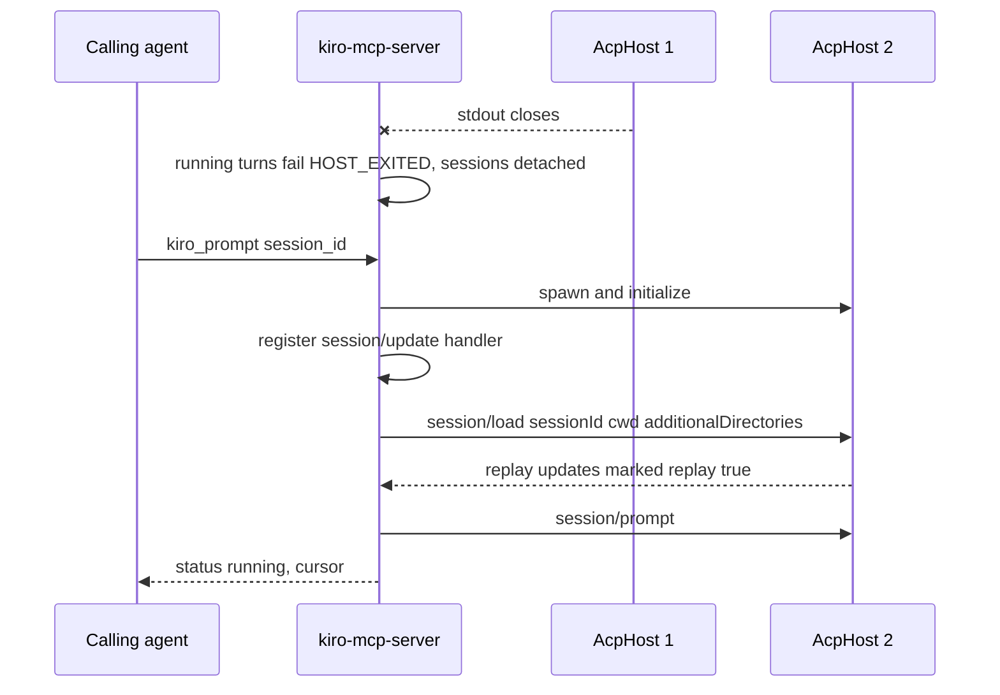

### Headless job

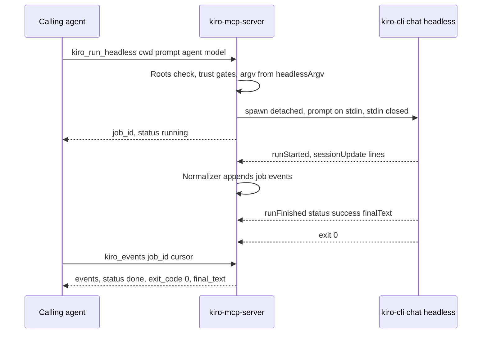

### Tangent merge

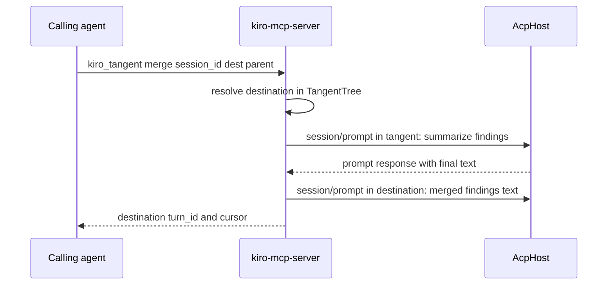

## Components and Interfaces

### Source layout

```text
src/index.ts              load config, connect StdioServerTransport, stopAll on shutdown, exit 2 on ConfigError
src/server.ts             createServer composition root, SERVER_INSTRUCTIONS, registers src/tools/*
src/config.ts             environment variables, validated once
src/errors.ts             ErrorCode, ToolError, toToolError (Kiro JSON-RPC errors to details.kiro)
src/paths.ts              Roots: parse, realpath, resolveInside
src/argv.ts               the only place argv is built (acp, headless, subcommands)
src/children.ts           ChildRegistry: detached spawn tracking, killGroup, scopes, stopAll
src/cli.ts                runCli: pipe spawn, timeout, 4 MiB cap, cleanTerminalText
src/prereq.ts             CLI lookup, version, install and sign-in messages
src/parse.ts              whoami JSON, settings JSON, mcp list and status text, agent validate, models JSON
src/acp/jsonrpc.ts        JsonRpcPeer: NDJSON framing, request ids, handlers, line cap
src/acp/host.ts           AcpHost: spawn, initialize, capabilities, call/notify, restart, method gating
src/acp/types.ts          TypeScript types for the ACP and Kiro payloads the server reads
src/sessions.ts           SessionRegistry, AttachedSession, snapshots, attach/detach/re-attach
src/events.ts             EventFeed (ring buffer, cursors, waiters), normalizeUpdate
src/turns.ts              TurnManager: start, wait, queue, steer, cancel, settle
src/permissions.ts        PermissionBroker: policy, pending store, respond, timeout
src/prompt.ts             buildPromptBlocks: text, files, images, command
src/tangent.ts            TangentTree
src/specs.ts              .kiro/specs listing and reading, tasks.md checkbox parse
src/jobs.ts               JobStore (headless jobs): ids, status, TTL and cap, settleWithin
src/headless.ts           runHeadlessJob: spawn, stdin prompt, stream-json parse, exit-code meaning
src/tools/status.ts       kiro_status, kiro_usage
src/tools/sessions.ts     kiro_session_* tools
src/tools/turns.ts        kiro_prompt, kiro_events, kiro_steer, kiro_cancel
src/tools/permissions.ts  kiro_permissions, kiro_permission_respond
src/tools/branching.ts    kiro_tangent
src/tools/extensions.ts   kiro_memory, kiro_knowledge, kiro_code_intelligence, kiro_workflow, kiro_cloud_sources
src/tools/specs.ts        kiro_specs
src/tools/headless.ts     kiro_run_headless
src/tools/config.ts       kiro_agents, kiro_mcp_config, kiro_settings, kiro_powers
src/tools/stream.ts       kiro_stream_session, the kiro-session://{session_id}/transcript resource, subscriptions
src/transcript.ts         readStream (type filter, max_chars, gap), TranscriptNotifier (coalesced resources/updated)
src/trust.ts              workspaceTrust(root): read-only check of Kiro's saved workspace trust
src/usage.ts              UsageReader: cached _kiro/account/getUsage reading, credit totals, the USAGE_LIMIT_NEAR guard
test/fixtures/fake-kiro.mjs   stand-in kiro-cli: acp server, headless chat, subcommands
skills/kiro-orchestration/SKILL.md   agent skill, plus references/ (Requirement 27)
scripts/check-skill-versions.mjs     SemVer check for every SKILL.md
```

### Tool table

All inputs are strict zod objects. Ids are validated with patterns:

| Pattern | Form |
| --- | --- |
| `SESSION_ID_PATTERN` | `sess_` followed by a UUID, or a bare UUID for imported V2 ids |
| `JOB_ID_PATTERN` | `job_` and 24 hex characters |
| `PERMISSION_ID_PATTERN` | `perm_` and 16 hex characters |
| `TURN_ID_PATTERN` | `turn_` and 16 hex characters |
| `REPO_PATTERN` | `owner/name` |
| `NAME_PATTERN` | `^[A-Za-z0-9][A-Za-z0-9._:/-]{0,127}$`, used for modes, commands, models, agents, recipes, and power names |
| `SETTING_KEY_PATTERN` | `^[A-Za-z][A-Za-z0-9_.-]{0,127}$` |

| Tool | Kiro call | Key inputs | Key outputs |
| --- | --- | --- | --- |
| `kiro_status` | `--version`, host `initialize`, `whoami --format json`, `profile`, optionally `diagnostic --format json` and `doctor --all` | `include_diagnostics?` | cli, version, engine_v3, capabilities, signed_in, account, roots, policy, log_paths, dropped_lines |
| `kiro_usage` | `_kiro/account/getUsage` (cached 60 s) | `session_id?`, `refresh?` | plan, reset_date, breakdowns, bonus_credits, add_on_credits, overages_enabled, session_credits, remaining_total, percent_used, checked_at, cached, stop_percent, blocked_by |
| `kiro_session_new` | `session/new`, then `_kiro/session/rename` | `cwd`, `additional_directories?`, `mode?`, `model?`, `effort?`, `title?`, `execution_target?` (`local` or `cloud`), `repos?` | session_id, modes, config_options, commands, context_usage, warnings |
| `kiro_session_list` | `session/list` | `scope?`, `cwd?`, `source?`, `title_contains?`, `limit?` | sessions, omitted_count |
| `kiro_session_load` | `session/load` | `session_id` or `latest` + `cwd`, `cwd?`, `additional_directories?` | session_id, modes, config_options, pending_permissions, replay_summary, cursor |
| `kiro_session_configure` | `session/set_mode`, `session/set_config_option`, `_kiro/session/rename` | `session_id`, `mode?`, `model?`, `effort?`, `options?`, `title?` | config_options, current_mode |
| `kiro_session_state` | cached snapshots, `_kiro/configuration/getState`, `_kiro/session/context`, `chat --list-models --format json` | `session_id?`, `include[]`, `verbose?` | one field per included kind, each with `received` |
| `kiro_session_history` | `_kiro/session/history` | `session_id`, `cursor?`, `limit?` | entries, rewind_points, has_more |
| `kiro_session_fork` | `session/fork` | `session_id`, `message_id?` | session_id, parent_session_id |
| `kiro_session_export` | `_kiro/session/export` | `session_id`, `path`, `overwrite?` | path, bytes |
| `kiro_session_compact` | `_kiro/session/compact` | `session_id` | context_usage |
| `kiro_session_close` | `session/close` | `session_id` | final_cursor |
| `kiro_session_delete` | `session/delete` | `session_id`, `confirm` | deleted |
| `kiro_prompt` | `session/prompt` | `session_id`, `text?`, `files?`, `images?`, `command?`, `wait_s?`, `when_busy?` | turn_id, status, cursor, final_text, stop_reason, tool_calls, credits, auto_rejected, pending_permissions |
| `kiro_events` | event feed | `session_id` or `job_id`, `cursor?`, `limit?`, `wait_s?`, `include_thoughts?` | events, next_cursor, lowest_cursor, status, pending_permissions, omitted_thoughts |
| `kiro_steer` | `_session/steer` | `session_id`, `text` | accepted, cursor |
| `kiro_cancel` | `session/cancel`, or job kill | `session_id` or `job_id` | status, turn |
| `kiro_permissions` | broker store | `session_id?` | pending |
| `kiro_permission_respond` | answers `session/request_permission` | `permission_id`, `option_id`, `scope?`, `resource?` | resolved, option_kind |
| `kiro_tangent` | `session/fork`, `session/prompt` | `action` (`branch`, `tree`, `merge`), `session_id`, `name?`, `destination?` | tangent_session_id, tree, merge turn |
| `kiro_specs` | filesystem under `cwd/.kiro/specs` | `action` (`list`, `read`), `cwd`, `spec?`, `document?` | specs or document, tasks |
| `kiro_memory` | `_kiro/memory/*` | `action`, `session_id`, `memory_id?`, `content?`, `confirm?` | Kiro result |
| `kiro_knowledge` | `_kiro/knowledge` | `session_id`, `subcommand`, `args` (typed per subcommand) | success, message, data |
| `kiro_code_intelligence` | `_kiro/codeIntelligence` | `session_id`, `subcommand`, `force?` | success, message, data |
| `kiro_workflow` | `_kiro/workflow/*` | `action`, `session_id`, `recipe?`, `inputs?`, `workflow_id?`, `node_id?` | recipes, runs, or run |
| `kiro_cloud_sources` | `_kiro/sourceProviders/list`, `listResources` | `session_id`, `provider?` | providers or resources |
| `kiro_run_headless` | `chat --v3 --no-interactive --output-format stream-json` | `cwd`, `prompt`, `agent?`, `model?`, `effort?`, `mode?`, `resume_id?`, `cloud?`, `repos?`, `require_mcp_startup?`, `require_sandbox?`, `trust_all_tools?`, `trust_tools?`, `trust_workspace?`, `workflow_timeout_s?`, `timeout_s?` | job_id, status (final fields when it finishes within the wait) |
| `kiro_agents` | ACP modes, `agent validate`, `create`, `set-default`, `upgrade` | `action`, `path?`, `name?`, `from?`, `directory?` | agents, errors, or command result |
| `kiro_mcp_config` | `mcp list`, `status`, `add --url`, `remove` | `action`, `scope?`, `name?`, `url?`, `agent?`, `timeout_ms?`, `disabled?`, `force?` | servers, raw |
| `kiro_settings` | `settings list --format json`, `settings <key> <value>`, `settings --delete` | `action`, `keys?`, `all?`, `key?`, `value?`, `workspace?` | settings |
| `kiro_powers` | powers snapshot, `powers install`, `uninstall` | `action`, `session_id?`, `name_or_path?` | powers or command result |
| `kiro_stream_session` | event feed, `session/load` when not attached | `session_id`, `cursor?`, `wait_s?`, `types?`, `max_chars?`, `include_thoughts?` | events, next_cursor, lowest_cursor, gap, truncated, turn_status, session_state, pending_permissions |

Resource template `kiro-session://{session_id}/transcript` (`application/json`): `{ session_id, session_state, turn_status, lowest_cursor, next_cursor, events }` with the newest events that fit the resource cap. `resources/list` lists attached and recently closed sessions. `resources/subscribe` and `resources/unsubscribe` are handled on the low-level server, and `TranscriptNotifier` sends `notifications/resources/updated` for subscribed URIs when their feed grows.

`kiro_stream_session` `types` values: `message`, `thought`, `tool_call`, `plan`, `permission` (both permission event types), `turn`, `state`, `steering`, `workflow`, `notice`, `unknown`. Thoughts are left out unless `include_thoughts` is true or `types` names `thought`.

### Core types

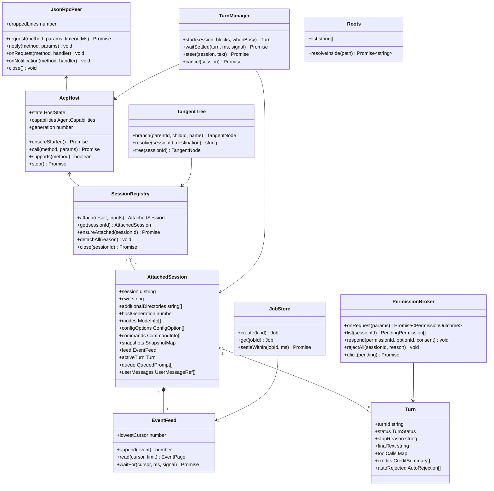

```ts
// src/events.ts
export type KiroEvent =
  | { seq: number; at: string; type: "message"; turnId?: string; text: string; replay?: true }
  | { seq: number; at: string; type: "thought"; turnId?: string; text: string; replay?: true }
  | { seq: number; at: string; type: "tool_call"; toolCallId: string; title: string; kind?: string;
      status: "pending" | "in_progress" | "completed" | "failed"; failureReason?: "cancelled" | "denied" | "error";
      rawInput?: unknown; rawOutputTail?: string }
  | { seq: number; at: string; type: "plan"; entries: { content: string; status: string; priority?: string }[] }
  | { seq: number; at: string; type: "permission_requested" | "permission_resolved"; permissionId: string;
      toolCallId: string; optionId?: string; policy?: "caller" | "shell_disabled" | "deny" | "allow" | "timeout" | "cancel" | "elicitation" }
  | { seq: number; at: string; type: "turn"; phase: "start" | "completion" | "end" | "settled"; turnId: string;
      stopReason?: string; credits?: CreditSummary[]; elapsedMs?: number }
  | { seq: number; at: string; type: "state"; kind: "mode" | "config" | "commands" | "context_usage" | "title" | "focus" }
  | { seq: number; at: string; type: "steering"; kind: "queued" | "injected" | "cleared" }
  | { seq: number; at: string; type: "workflow"; workflowId?: string; status?: string; detail: unknown }
  | { seq: number; at: string; type: "notice"; kind: "rate_limit" | "model_fallback" | "host_exited" | "config_error" | "headless_stderr"; message: string }
  | { seq: number; at: string; type: "unknown"; method: string; sessionUpdate?: string };

export function normalizeUpdate(params: unknown, ctx: NormalizeContext): Omit<KiroEvent, "seq" | "at">[];
```

```ts
// src/permissions.ts
export type PermissionPolicy = "ask" | "deny" | "allow";
export interface PendingPermission {
  permissionId: string;          // perm_<16 hex>, server-assigned
  sessionId: string;
  toolCallId: string;
  title: string;
  options: { optionId: string; name: string; kind: "allow_once" | "allow_always" | "reject_once" | "reject_always" }[];
  consent?: { capability?: string; resource?: string; triggeringResource?: string; workspaceRoot?: string; persistableConsent?: boolean };
  mcpTool?: { serverName?: string; toolName?: string; annotations?: Record<string, boolean> }; // display only, untrusted
  createdAt: string;
  expiresAt: string;
}
export function decideByPolicy(req: PendingPermission, cfg: PolicyConfig):
  { kind: "pending" } | { kind: "answer"; optionId: string; policy: "shell_disabled" | "deny" | "allow" } | { kind: "cancelled" };
```

```ts
// src/argv.ts (fixed order; values attached with =, prompts on stdin)
export function acpArgv(): string[]; // ["acp", "--agent-engine=v3", "--auth-method=cli"]
export function headlessArgv(o: HeadlessOptions): string[];
// ["chat", "--v3", "--no-interactive", "--output-format=stream-json", "--wrap=never",
//  "--agent=<a>"?, "--model=<m>"?, "--effort=<e>"?, "--mode=<default|spec>"?, "--resume-id=<id>"?,
//  "--cloud"?, "--repo=<a,b>"?, "--require-mcp-startup"?, "--sandbox"?,
//  "--trust-all-tools"? | "--trust-tools=<ids>"?, "--trust-workspace"?]
export function assertAcp(argv: string[]): void;      // refuses --agent, --model, --effort, --trust-*
export function assertHeadless(argv: string[]): void; // refuses a positional prompt and unknown flags
export function subcommandArgv(cmd: SubcommandSpec): string[]; // whoami, settings, agent, mcp, powers, diagnostic, doctor --all
```

### Live transcript stream

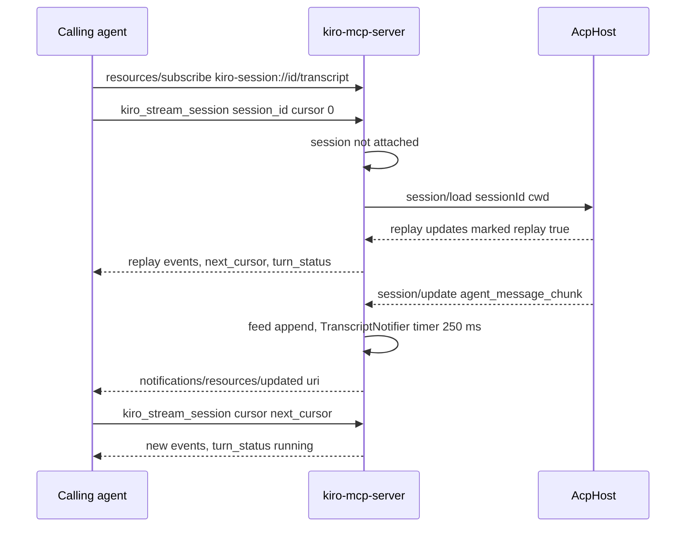

```ts
// src/trust.ts
export type TrustState = true | false | null; // null: file unreadable or unparsable
export function workspaceTrust(root: string, home?: string): Promise<TrustState>;
// sha256(realpath(root)).hex.slice(0, 16) under <home>/.kiro/workspace-roots/, line `workspaceTrusted: true`
```

```ts
// src/transcript.ts
export interface StreamPage { events: KiroEvent[]; nextCursor: number; lowestCursor: number; gap: boolean; truncated: boolean; omittedThoughts: number }
export function readStream(feed: EventFeed, cursor: number, o: { types?: string[]; maxChars: number; limit: number; includeThoughts: boolean }): StreamPage;
export class TranscriptNotifier { subscribe(uri: string): void; unsubscribe(uri: string): void; touched(sessionId: string): void }
```

### Server instructions

`SERVER_INSTRUCTIONS` (Requirement 25.5) tells calling agents:

- Call `kiro_status` first.
- Prompt with `kiro_prompt`, then poll `kiro_events` with the returned cursor until `status` is `completed`, `cancelled`, or `failed`.
- Answer `pending_permissions` with an `option_id` from the offered list only.
- A turn finishes only from the prompt response.
- Compose `/clear` as `kiro_session_new`, `/spawn` as `kiro_session_new` plus `kiro_prompt`, `/spec run` as Spec mode plus a prompt, and `/goal` as `kiro_workflow` or `autonomous` mode.
- Follow a run live with `kiro_stream_session`, or subscribe to `kiro-session://<id>/transcript`.
- Shell approvals are off unless the operator sets `KIRO_MCP_ALLOW_SHELL`, and workspaces must be trusted once in `kiro-cli --v3`.
- A turn's `auto_rejected` lists requests the server rejected on its own, each with the setting that would change it. A client that declines approval forms without showing them needs `KIRO_MCP_ELICITATION=off`.
- Check `kiro_usage` before fanning out work. `USAGE_LIMIT_NEAR` means the operator's credit threshold is reached: wait for the reset date rather than retrying.
- Impossible features: archive import, attaching a repository later, file checkpoints, MCP OAuth, login, ACP workspace trust. Each comes with its reason.

### Configuration

All variables are optional. Invalid values exit with code 2.

| Variable | Default | Role |
| --- | --- | --- |
| `KIRO_BIN` | `kiro-cli` | CLI path or name |
| `KIRO_MCP_CWD` | `process.cwd()` | Default root when `KIRO_MCP_ROOTS` is unset, and the host `cwd` |
| `KIRO_MCP_ROOTS` | `KIRO_MCP_CWD` | Comma-separated absolute directories, stored as real paths |
| `KIRO_MCP_PERMISSIONS` | `ask` | `ask`, `deny`, or `allow` (Requirement 12) |
| `KIRO_MCP_PERMISSION_TIMEOUT_MS` | `600000` | Auto-reject after this long |
| `KIRO_MCP_ALLOW_SHELL` | off | Lets shell-capability requests be approved |
| `KIRO_MCP_ALLOW_PERSISTENT_CONSENT` | off | Allows `allow_always` responses |
| `KIRO_MCP_ELICITATION` | `on` | `on` or `off`. `off` stops forwarding pending permissions as form elicitations (12.12) |
| `KIRO_MCP_USAGE_STOP_PERCENT` | unset | An integer from 1 to 100. New work fails with `USAGE_LIMIT_NEAR` at or above this share of credits used (3.6) |
| `KIRO_MCP_HEADLESS_TRUST` | `none` | `none`, `tools`, or `all` |
| `KIRO_MCP_ALLOW_TRUST_WORKSPACE` | off | Allows headless `--trust-workspace` |
| `KIRO_MCP_ALLOW_CONFIG_WRITES` | off | Allows agent, MCP, settings, and powers writes |
| `KIRO_MCP_CLI_TIMEOUT_MS` | `120000` | Subcommand timeout |
| `KIRO_MCP_REQUEST_TIMEOUT_MS` | `120000` | Timeout for ACP requests other than `session/prompt` |
| `KIRO_MCP_HEADLESS_TIMEOUT_MS` | `3600000` | Headless job timeout. `timeout_s` overrides it, up to the same cap |

Booleans accept `1`, `true`, `yes` and `0`, `false`, `no`.

Fixed limits, in `src/config.ts`:

| Limit | Value |
| --- | --- |
| `prompt` and `events` `wait_s` | Default 20, maximum 55 |
| Line cap (`MAX_LINE_BYTES`) | 16 MiB |
| Event feed | 2,000 events or 4 MiB per session or job |
| Embedded file cap | 256 KiB, up to 20 files |
| Image cap | 5 MiB, up to 10 images |
| Prompt queue | 5 per session |
| Cancel settle wait | 30 s |
| Job TTL | 1 h, up to 100 finished jobs |
| Output tail | 8,000 characters |
| Snapshot field cap | 4,000 characters |
| Spec read cap | 200 KiB |
| Repositories per cloud session | 10 |
| `kiro_stream_session` `wait_s` | Default 1, maximum 55 |
| `kiro_stream_session` `max_chars` | Default 20,000, maximum 200,000 |
| Transcript resource cap | 256 KiB of serialized events, newest kept |
| Resource update coalescing | 250 ms |
| Closed-session feed retention | The job TTL, up to 50 closed sessions |

## Data Models

All state lives in memory (Requirement 24.6). Nothing is persisted by the server.

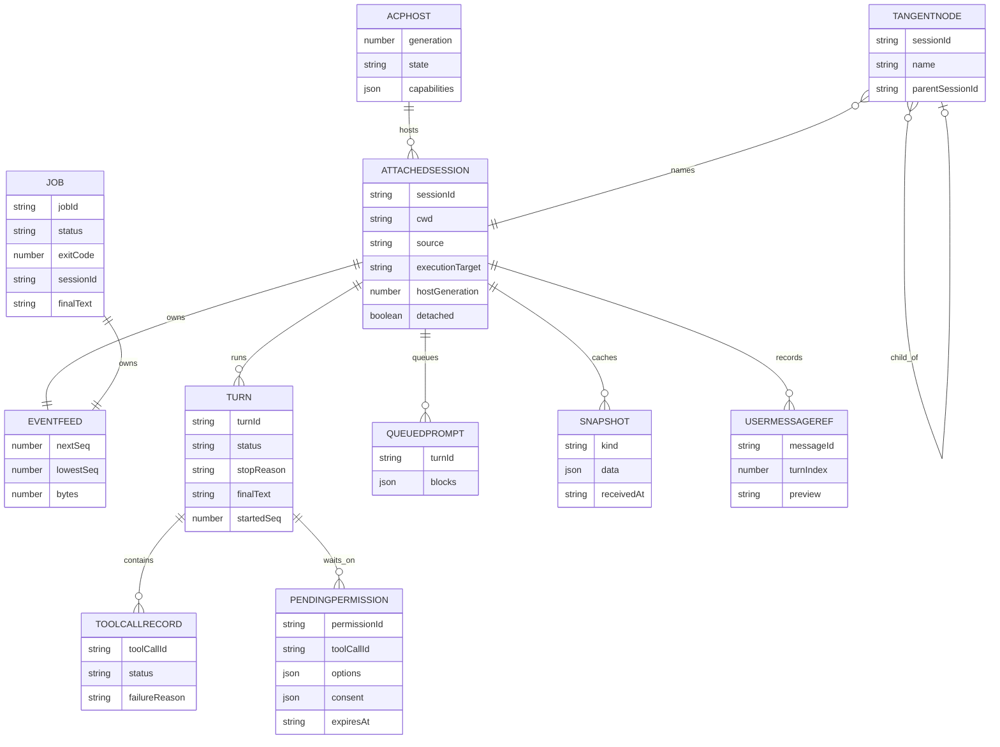

Host lifecycle:

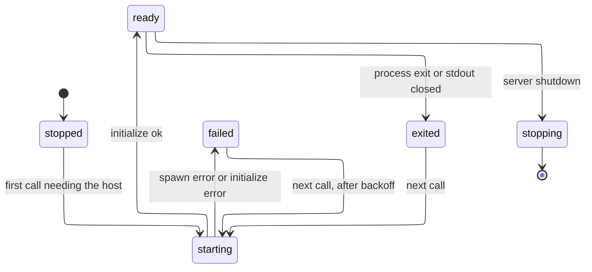

Headless job lifecycle (a failed job reports its tool error when read, never an `error` status):

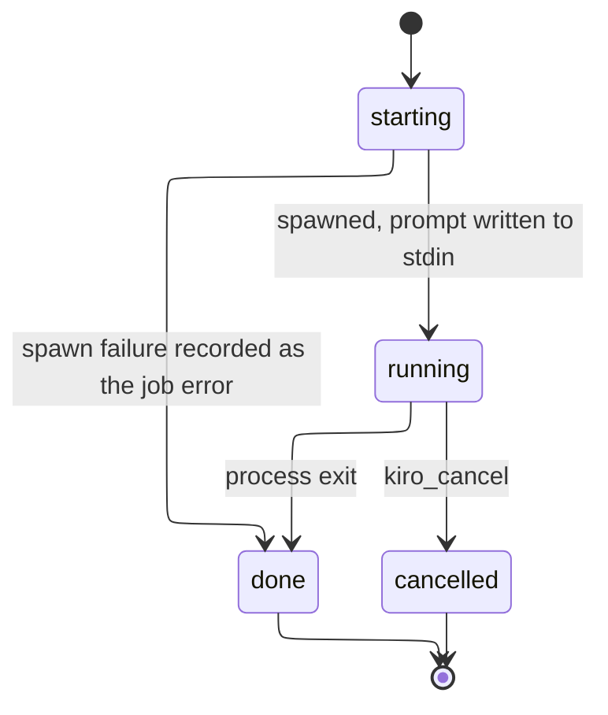

## Error Handling

`ErrorCode` values:

| Area | Codes |
| --- | --- |
| CLI and engine | `CLI_NOT_FOUND`, `CLI_NOT_SIGNED_IN`, `ENGINE_V3_UNAVAILABLE`, `HOST_EXITED`, `UNSUPPORTED_BY_KIRO`, `KIRO_ERROR`, `KIRO_REFUSED`, `OUTPUT_PARSE_FAILED`, `TIMEOUT`, `CLI_EXIT` |
| Paths and content | `PATH_OUTSIDE_ROOTS`, `PATH_EXISTS`, `CONTENT_TOO_LARGE` |
| Sessions and turns | `SESSION_NOT_FOUND`, `TURN_ACTIVE`, `NO_ACTIVE_TURN`, `QUEUE_FULL`, `VALUE_NOT_ADVERTISED` |
| Permissions | `PERMISSION_NOT_FOUND`, `OPTION_NOT_OFFERED`, `PERSISTENT_CONSENT_DISABLED`, `SHELL_APPROVAL_DISABLED` |
| Operator gates | `HEADLESS_TRUST_DISABLED`, `CONFIG_WRITES_DISABLED`, `STDIO_SERVER_WITHHELD`, `SETTING_WITHHELD`, `CONFIRMATION_REQUIRED`, `USAGE_LIMIT_NEAR` |
| Lookups | `JOB_NOT_FOUND`, `SPEC_NOT_FOUND`, `TANGENT_NOT_FOUND`, `INVALID_MERGE_TARGET`, `NOTHING_TO_BRANCH` |

The error body is `{ error: { code, message, details } }`. `details.kiro` holds `{ code, message, errorType }` from a Kiro JSON-RPC error. `details.cli` holds `{ exitCode, stdoutTail, stderrTail }` with control sequences removed.

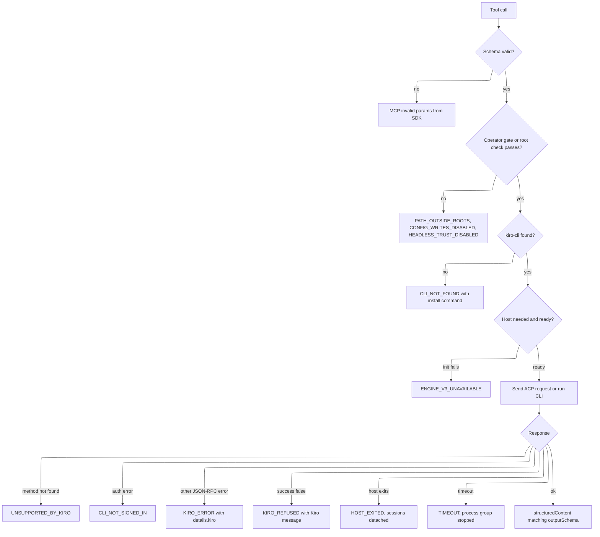

- Advertised-value checks (`VALUE_NOT_ADVERTISED`) run against the session's latest snapshot before any request is sent.
- Unknown agent-to-client requests get a JSON-RPC `-32601` error at once (Requirement 5.3).
- A malformed or oversized host line is dropped and counted. The connection stays open (Requirement 5.7).
- A Kiro exit code 3 or 4 on a headless job is a normal `done` job with `exit_meaning` set, not a tool error.

## Testing Strategy

`npm test` builds, then runs `node --test` on the compiled tests, as the sibling does. No test talks to Kiro's service or a real `kiro-cli`. The fake fixture `test/fixtures/fake-kiro.mjs` stands in for the binary through `KIRO_BIN`:

- **`acp`**: an NDJSON JSON-RPC server. It answers `initialize` with the probed capability shape, and implements `session/new`, `list`, `load` (with replay marked `replay: true`), `prompt`, `cancel`, `set_mode`, `set_config_option`, `fork`, `close`, `delete`, and the `_kiro/*` methods the server calls. `FAKE_KIRO_SCENARIO` selects a scripted turn: plain answer, tool call with a permission request, long turn, rate-limit notice, method-not-found, host crash mid-turn, oversized line, unknown update type. The fake records each request it receives and its own `pid` in a meta log, so tests can assert argv, the absence of v2 flags, and process exit.
- **`chat --v3 --no-interactive --output-format=stream-json`**: reads the prompt from stdin and writes `runStarted`, `sessionUpdate`, and `runFinished` lines. It can exit with 0, 3, or 4, or hang until it is killed.
- **Subcommands**: `--version`, `whoami --format json` (signed in or signed out), `profile`, `settings list --format json`, `settings <k> <v>`, `agent validate`, `agent create`, `mcp list`, `mcp status`, `mcp add`, `powers install`, `diagnostic --format json`, `doctor --all`, `chat --list-models --format json`.

| Test file | Covers |
| --- | --- |
| `test/jsonrpc.test.ts` | Framing across chunk boundaries, ids, request and notification routing, `-32601` for unknown requests, line cap, invalid JSON counting |
| `test/events.test.ts` | Normalizer for every probed update kind, chunk coalescing, tool-call merge by `toolCallId`, replay marking, ring-buffer caps and `lowestCursor`, `waitFor` |
| `test/permissions.test.ts` | Policy matrix (`ask`, `deny`, `allow`) × capability (shell, other) × options offered, persistent consent gate, timeout, never synthesizing an option, cancel, no elicitation with `KIRO_MCP_ELICITATION=off` |
| `test/usage.test.ts` | Usage normalization (`remaining_total`, `percent_used` with plan, bonus, and add-on pools, missing numbers), the 60 s cache and `refresh` (injected clock), one shared in-flight read, the guard threshold and the unreadable case |
| `test/paths.test.ts` | Roots parsing, `/` refused, symlink in and out, prefix-sibling, macOS `/tmp` vs `/private/tmp` |
| `test/argv-config.test.ts` | `acpArgv` has no v2 flags, `headlessArgv` order and gates, subcommand argv, env validation exit 2 |
| `test/parse.test.ts` | whoami JSON, settings JSON, `mcp list` and `status` text with ANSI codes, models JSON, tasks.md checkbox parse |
| `test/prompt.test.ts` | Content blocks for text, `resource_link`, embedded text, images from path and base64, size and type caps, command check against the catalog |
| `test/tangent.test.ts` | Branch naming `tangent-N`, nested tree, merge destination resolution and errors |
| `test/jobs.test.ts` | Job ids, status, TTL and cap, `settleWithin` (injected clock) |
| `test/children.test.ts` | Process groups, scope cancel, `stopAll` (real `node` children, including a grandchild) |
| `test/host.test.ts` | Spawn and initialize against the fake, method gating (`KNOWN_UNADVERTISED`), crash detaches sessions, re-attach with `session/load` before the next call, no prompt resent |
| `test/transcript.test.ts` | `readStream` type filter with cursor advance, `max_chars` truncation and resume, `gap`, idempotent re-reads, notifier coalescing (injected timer) |
| `test/trust.test.ts` | `workspaceTrust` against a temp `HOME`: trusted, missing file, unreadable file, home directory |
| `test/smoke.test.ts` | Every tool over stdio through the SDK `Client`: schemas and `outputSchema`, server instructions, prompt-then-poll, permission respond, steer, cancel, fork, tangent, specs, extensions, cloud target, headless job lifecycle and exit codes, config write gates, error bodies, shutdown stopping every child, `kiro_stream_session` on a loaded (not attached) session with replay, cancel and close, the transcript resource read, subscribe and `notifications/resources/updated`, elicitation accept, decline, and cancel through a client that declares the capability, no form with `KIRO_MCP_ELICITATION=off`, `auto_rejected` hints for `shell_disabled` and `elicitation`, and `kiro_usage` cache, `refresh`, and `USAGE_LIMIT_NEAR` on `kiro_prompt` and `kiro_run_headless` |

CI also runs a `skills` job: `node scripts/check-skill-versions.mjs skills`, then `npx -y skills add "$GITHUB_WORKSPACE" -g -y -a claude-code -a codex --json` with a throwaway `HOME` and `CI=true`, then `jq` asserts every entry is `installed` and a shell loop asserts each `skills/*/SKILL.md` exists under `$HOME/.agents/skills/` (Requirement 27.5).

Smoke cases poll with helpers that wait for a condition (`pollEvents`, `waitFor`), never fixed sleeps. Unit tests use an injected clock for timeouts and TTLs. CI runs on `ubuntu-latest` with Node 22. Tests need nothing but Node.
