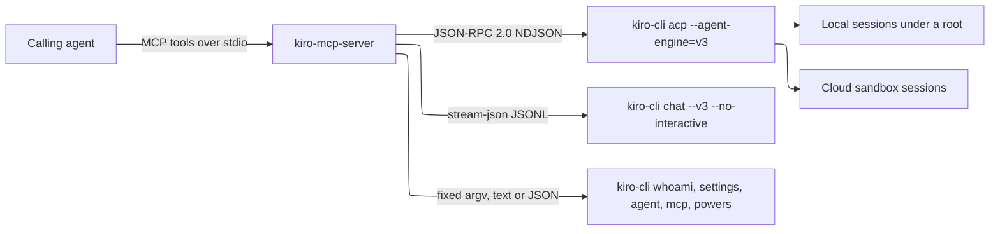
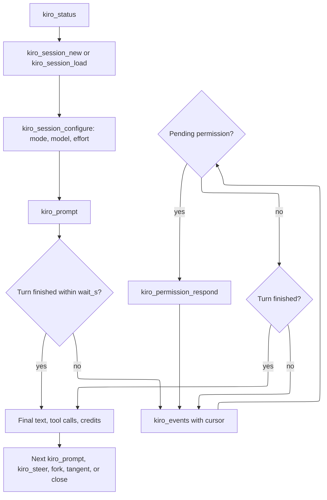
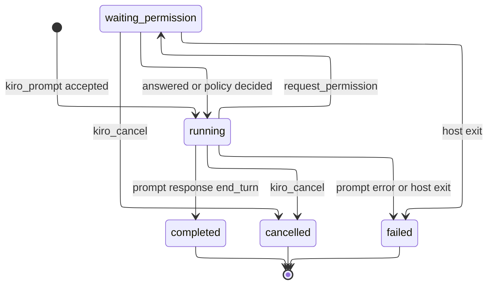
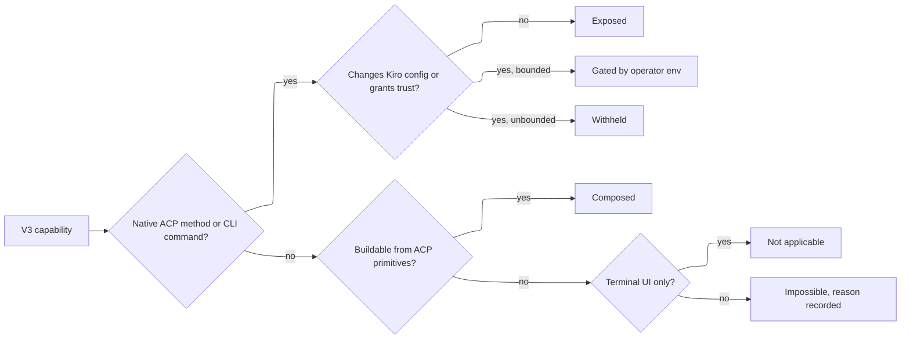

# Requirements Document

## Introduction

`kiro-mcp-server` is an MCP stdio server that lets a calling agent (Grok Bot, Claude, Cursor, Codex, or any MCP client) orchestrate Kiro CLI V3 coding sessions through typed tools. It is a sibling of `claude-code-mcp-server` and follows its conventions: strict schemas, fixed argv, structured output, process-group cleanup, and no escape hatch.

The server drives Kiro in two ways:

- **ACP host**: one long-lived `kiro-cli acp --agent-engine=v3 --auth-method=cli` child process. The server speaks newline-delimited JSON-RPC 2.0 to it. This path handles sessions, prompts, streaming updates, permissions, and Kiro extension methods.
- **Headless runs**: `kiro-cli chat --v3 --no-interactive --output-format stream-json` child processes for fire-and-forget or CI-style runs.

A few `kiro-cli` subcommands exist only as CLI commands, such as `whoami`, `settings`, `agent`, `mcp`, and `powers`. The server runs those with fixed argv.

Behavior is designed against the installed Kiro CLI 2.37.1, which ships the V3 engine as KAS 0.66.70, and against the V3 docs fetched on 2026-11-02. The design records the live ACP probe that confirmed method names and payload shapes.

Terms used throughout:

| Term | Meaning |
| --- | --- |
| calling agent | The MCP client that calls the server's tools |
| operator | The person who installs the server and sets its environment variables |
| host | The ACP child process `kiro-cli acp --agent-engine=v3` |
| attached session | A Kiro session the server created or loaded on the current host |
| turn | One `session/prompt` request and the updates it produces until its response arrives |
| event feed | The server's per-session buffer of normalized updates, read with a cursor |
| pending permission | A `session/request_permission` request from Kiro that has not been answered yet |
| root | An absolute directory, from `KIRO_MCP_ROOTS`, that the server may run Kiro in |
| job | A headless run tracked in memory by the server |
| config writes | Calls that change Kiro configuration on disk: agents, MCP config, settings, powers |

### Typical orchestration flow

### Turn lifecycle

## Requirements

### Requirement 1

**User Story:** As an operator, I want to start the server with `npx` and have it explain a missing or unsupported Kiro CLI, so that I can wire it into any MCP client without guesswork.

#### Acceptance Criteria

1. WHEN the operator runs `npx -y @sohampatwardhan/kiro-mcp-server@latest` THEN the server SHALL speak MCP over stdio as server name `kiro-mcp-server`, write logs only to stderr, and expose exactly the tools listed in the design's tool table.
2. IF an environment variable the server reads has an invalid value THEN the server SHALL print the variable name and the reason on stderr and exit with code 2 before connecting the transport.
3. IF the `kiro-cli` binary (or `KIRO_BIN`) cannot be found THEN every tool that needs it SHALL fail with `CLI_NOT_FOUND`, and the error message SHALL include the install command from the Kiro docs. The server SHALL also print the same warning on stderr at startup.
4. IF the CLI is found but `acp --agent-engine=v3` fails to initialize THEN tools that need the host SHALL fail with `ENGINE_V3_UNAVAILABLE`, naming the CLI version and the stderr reason.
5. WHEN a `v*.*.*` tag that matches `package.json` is pushed THEN the release workflow SHALL build, test, and publish to npm with provenance through trusted publishing, create a GitHub release, and mirror the package to GitHub Packages.
6. WHEN any push or pull request reaches GitHub THEN CI SHALL run install, build (typecheck), and the full test suite against the fake Kiro fixture, never a real `kiro-cli`.

### Requirement 2

**User Story:** As a calling agent, I want one status call that tells me whether Kiro is installed, signed in, and V3-capable, so that I know what will work before I start a session.

#### Acceptance Criteria

1. WHEN the calling agent calls `kiro_status` THEN the server SHALL return:
   - the CLI path and version;
   - whether the V3 ACP host initialized;
   - the host's advertised capabilities: prompt capabilities, session capabilities, `extensionMethods`, session sources, list scopes, execution targets, and the auto-compaction range;
   - the effective roots and policy settings;
   - the Kiro log directory paths the host advertised.
2. WHEN `kiro_status` runs THEN the server SHALL report sign-in state from `kiro-cli whoami --format json`. It SHALL copy only `accountType`, `email`, and the profile name when present.
3. IF `whoami` reports that the user is not signed in THEN `kiro_status` SHALL return `signed_in: false` with the instruction to run `kiro-cli login` (or `kiro-cli login --use-device-flow` on a machine without a browser) in a terminal. It SHALL NOT start a login flow.
4. WHERE the calling agent passes `include_diagnostics: true` THEN `kiro_status` SHALL also return the output of `kiro-cli diagnostic --format json` and `kiro-cli doctor --all`. It SHALL never run `doctor` without `--all`, because that form may apply fixes.
5. IF a tool other than `kiro_status` fails because Kiro reports an authentication error THEN that tool SHALL fail with `CLI_NOT_SIGNED_IN` and the same sign-in instruction.
6. WHEN `kiro_status` runs THEN it SHALL report, for each root, whether Kiro has saved workspace trust for it (`true`, `false`, or `null` when unknown). IF a root is not trusted THEN `kiro_status` SHALL add a warning telling the operator to run `kiro-cli --v3` once in that folder and choose **Trust, continue**. The server SHALL never write trust itself.

### Requirement 3

**User Story:** As a calling agent, I want to see plan usage and per-turn credits, so that I can budget long-running orchestration.

#### Acceptance Criteria

1. WHEN the calling agent calls `kiro_usage` THEN the server SHALL call `_kiro/account/getUsage` on the host and return:
   - the plan name;
   - the billing cycle reset date;
   - the usage breakdowns: resource type, used, limit, and percentage;
   - bonus and add-on credits;
   - whether overages are enabled.
2. WHEN a turn finishes and the host sent a `session_info_update` with `_meta.kiro.kind: "turn_completion"` THEN the turn result SHALL include each `promptTurnSummaries` entry (unit, usage, used tools) and the elapsed time.
3. WHEN `kiro_usage` is called with a `session_id` of an attached session THEN the result SHALL also include the sum of credits the server observed for that session's turns since it was attached.
4. IF the host answers `_kiro/account/getUsage` with method-not-found THEN `kiro_usage` SHALL fail with `UNSUPPORTED_BY_KIRO` and still return the per-session totals when a `session_id` was given.
5. WHEN `kiro_usage` returns THEN its result SHALL also include:
   - `checked_at` (ISO 8601) for when the plan reading was taken, and `cached` saying whether it was reused;
   - `remaining_total`: plan credits left (limit minus used, over the breakdowns) plus bonus and add-on credits left (total minus used), or `null` when no pool carries numbers;
   - `percent_used`: credits used over the credit limit across those same pools, from 0 to 100, or `null` when no pool has a limit;
   - `stop_percent` (the operator's `KIRO_MCP_USAGE_STOP_PERCENT`, or `null`) and `blocked_by` (a one-line reason when the guard in criterion 6 would refuse new work, otherwise `null`).
   The server SHALL reuse a plan reading for 60 s and share one host request between concurrent calls. `refresh: true` SHALL take a new reading. Reading usage SHALL never start a model turn.
6. WHERE `KIRO_MCP_USAGE_STOP_PERCENT` is set (an integer from 1 to 100) THEN, before `kiro_prompt`, `kiro_tangent` `merge`, `kiro_workflow` `invoke`, or `kiro_run_headless` starts work, the server SHALL read usage (a cached reading counts) and fail with `USAGE_LIMIT_NEAR` when `percent_used` is at or above the threshold. The message SHALL name the percent used, the credits left, and the reset date, and nothing SHALL be sent to Kiro. IF usage cannot be read THEN the work SHALL go ahead. `kiro_steer`, `kiro_cancel`, and `kiro_session_compact` SHALL NOT be guarded.

### Requirement 4

**User Story:** As an operator, I want Kiro to run only inside directories I list, so that a calling agent cannot point it at the rest of my machine.

#### Acceptance Criteria

1. WHEN the server starts THEN it SHALL read `KIRO_MCP_ROOTS` as comma-separated absolute directories and store each as its real path. When the variable is unset, the only root SHALL be `KIRO_MCP_CWD`, or the process working directory when that is unset too.
2. IF a root resolves to `/` or is not an existing directory THEN the server SHALL exit with code 2 at startup.
3. WHEN a tool receives any path (`cwd`, `additional_directories`, file and image context, export destination, headless `cwd`, agent directory) THEN the server SHALL resolve it with `realpath` and accept it only when it is a root or inside a root.
4. IF a path resolves outside every root, including through a symlink or a sibling directory that shares a name prefix with a root, THEN the tool SHALL fail with `PATH_OUTSIDE_ROOTS` before any process is spawned or any request is sent to the host.
5. WHEN the server sends a `cwd` to Kiro THEN it SHALL send the resolved real path, so that `session/list` filtering matches. On macOS, `/tmp` and `/private/tmp` resolve to the same path.

### Requirement 5

**User Story:** As a calling agent, I want the server to manage one V3 ACP host for me, so that sessions keep their MCP servers and state across my tool calls.

#### Acceptance Criteria

1. WHEN the first tool that needs the host is called THEN the server SHALL spawn `kiro-cli acp --agent-engine=v3 --auth-method=cli` with no other flags. It SHALL register handlers for `session/update`, `session/request_permission`, and all `_kiro/*` notifications, and then call `initialize`.
2. The server SHALL NOT pass `--agent`, `--model`, `--effort`, `--trust-all-tools`, or `--trust-tools` to the `acp` command. Agent mode, model, and effort SHALL be set only through session inputs and `session/set_config_option` or `session/set_mode`.
3. WHEN the host sends an agent-to-client request that the server does not implement, including `fs/*`, `terminal/*`, `_kiro/auth/getAccessToken`, and `_kiro/openExternalUrl`, THEN the server SHALL answer with a JSON-RPC error so that the host never waits.
4. WHEN the server calls an optional Kiro extension method THEN it SHALL either call it because the method is in the advertised `extensionMethods`, or call it because the design lists it as a known unadvertised method. In both cases it SHALL map a JSON-RPC method-not-found response to `UNSUPPORTED_BY_KIRO`.
5. IF the host process exits or its stdout closes THEN the server SHALL:
   - fail every running turn with `HOST_EXITED`;
   - mark every attached session as detached;
   - start a new host on the next call that needs one.

   It SHALL NOT resend any prompt automatically.
6. WHEN a call names a detached session THEN the server SHALL re-attach it with `session/load` on the new host before the call proceeds, resending the session's `cwd` and `additionalDirectories`.
7. IF the host writes a line that is not valid JSON, or a line longer than the line cap, THEN the server SHALL drop the line, count it in `kiro_status`, and keep the connection open.

### Requirement 6

**User Story:** As a calling agent, I want to start a new Kiro session in a workspace with the mode, model, and effort I choose, so that each task gets the right agent.

#### Acceptance Criteria

1. WHEN the calling agent calls `kiro_session_new` with a `cwd` inside a root THEN the server SHALL send `session/new` with that `cwd`, any `additional_directories`, and `mcpServers: []`. It SHALL return:
   - the session id;
   - the available modes, with custom agents marked by source;
   - the config options with their current values and allowed values;
   - the command catalog counts by type;
   - the initial context usage.
2. WHERE `mode`, `model`, or `effort` is given on `kiro_session_new` THEN the server SHALL send them as `_meta.kiro.modeId`, `modelId`, and `effortLevel`. It SHALL then confirm each one against the returned config options and report any value Kiro did not apply in `warnings`.
3. WHEN `kiro_session_new` is called with `title` THEN the server SHALL rename the session through `_kiro/session/rename` after creation.
4. The server SHALL NOT accept caller-supplied MCP server definitions for `session/new`. The `mcpServers` list SHALL always be empty, because a stdio server definition is an arbitrary command.
5. WHEN a session is created or loaded THEN the server SHALL hold it as an attached session with its own event feed, so that several sessions can run turns concurrently on one host.

### Requirement 7

**User Story:** As a calling agent, I want to list existing local and cloud sessions and resume one, so that I can continue earlier work instead of starting over.

#### Acceptance Criteria

1. WHEN the calling agent calls `kiro_session_list` THEN the server SHALL call `session/list` with the given `scope` (`workspace` or `user`) and `cwd`. It SHALL return, for each session: id, cwd, title, updated time, source (`local` or `remote`), execution target, status, and agent mode.
2. WHEN `kiro_session_list` is called with `source`, `title_contains`, or `limit` THEN the server SHALL filter and truncate the host's list itself and say how many sessions it left out.
3. WHEN `kiro_session_list` is called with scope `user` THEN the server SHALL leave out local sessions whose `cwd` is outside every root. It SHALL report the count it left out, not their paths.
4. WHEN the calling agent calls `kiro_session_load` with a session id THEN the server SHALL register its update handler first, then send `session/load` with the session's real `cwd` (or the given `cwd` inside a root), `additionalDirectories`, and `mcpServers: []`. It SHALL return the session's modes, config options, and any pending permissions.
5. WHEN `kiro_session_load` replays history THEN the server SHALL store replayed updates in the event feed marked `replay: true`, and return a short replay summary: the message count and the last agent message text, truncated.
6. WHEN `kiro_session_load` is called with `latest: true` and a `cwd` instead of a session id THEN the server SHALL load the most recently updated session for that workspace, matching `kiro-cli chat --resume`.
7. IF the session id is unknown to the host THEN `kiro_session_load` SHALL fail with `SESSION_NOT_FOUND`.

### Requirement 8

**User Story:** As a calling agent, I want to close, rename, export, and delete sessions, so that I can manage the session store the way `/chat` and the session dashboard do.

#### Acceptance Criteria

1. WHEN the calling agent calls `kiro_session_close` THEN the server SHALL:
   - cancel the session's running turn;
   - reject its pending permissions;
   - call `session/close`;
   - return the final cursor, and keep the event feed read-only for the job TTL so that streams can drain it (Requirement 26), then drop it.
2. WHEN the calling agent calls `kiro_session_delete` with `confirm: true` THEN the server SHALL close the session if it is attached and call `session/delete`.
3. IF `kiro_session_delete` is called without `confirm: true` THEN the server SHALL fail with `CONFIRMATION_REQUIRED` and delete nothing.
4. IF `kiro_session_delete` names a local session whose `cwd` is outside every root THEN it SHALL fail with `PATH_OUTSIDE_ROOTS`.
5. WHEN the calling agent calls `kiro_session_configure` with `title` THEN the server SHALL call `_kiro/session/rename`.
6. WHEN the calling agent calls `kiro_session_export` with a destination path inside a root THEN the server SHALL call `_kiro/session/export` and return the written path and size.
7. IF the destination path already exists and `overwrite` is not `true` THEN `kiro_session_export` SHALL fail with `PATH_EXISTS`.

### Requirement 9

**User Story:** As a calling agent, I want to send prompts with file, image, skill, and sub-agent context, so that Kiro gets everything it needs in one turn.

#### Acceptance Criteria

1. WHEN the calling agent calls `kiro_prompt` with `text` for an idle attached session THEN the server SHALL send `session/prompt` and wait up to `wait_s`, with a default and a maximum set in the design. It SHALL return the finished turn result, or `status: "running"` with a `turn_id` and the current cursor.
2. WHEN `kiro_prompt` includes `files` THEN the server SHALL add, for each file inside a root, either:
   - a `resource_link` block, by default; or
   - an embedded `resource` text block when `embed: true` and the file is UTF-8 text under the embed cap.

   It SHALL fail with `CONTENT_TOO_LARGE` otherwise.
3. WHEN `kiro_prompt` includes `images` THEN the server SHALL add one ACP `image` block per image. Each image comes from a file inside a root or from base64 data with a mime type, and must be PNG, JPEG, GIF, or WebP under the image cap. The server SHALL refuse images when the host's `promptCapabilities.image` is false.
4. WHEN `kiro_prompt` includes `command` with a `name` and an optional `input` THEN the server SHALL check the name against the session's latest `available_commands_update` and send the prompt text `/<name> <input>`. This covers skills, MCP prompts, and custom-agent sub-agents.
5. IF the `command` name is not in the advertised catalog THEN `kiro_prompt` SHALL fail with `VALUE_NOT_ADVERTISED`, list the closest advertised names, and send nothing.
6. IF the session already has a running turn and `when_busy` is `reject` (the default) THEN `kiro_prompt` SHALL fail with `TURN_ACTIVE`.
7. WHEN `when_busy` is `queue` THEN the server SHALL queue the prompt and send it after the running turn's response arrives. A session SHALL hold at most the queue cap of waiting prompts.
8. WHEN `kiro_prompt` text starts with `@<prompt-name>` THEN the server SHALL pass it unchanged, so that Kiro runs the named prompt or SOP as it does for a first message.

### Requirement 10

**User Story:** As a calling agent, I want to follow a turn's streaming progress and tool calls with a cursor, so that I can report progress and react while Kiro works.

#### Acceptance Criteria

1. WHEN the host sends `session/update` for an attached session THEN the server SHALL route it by `sessionId`, keep the arrival order, and append a normalized event with a monotonically increasing sequence number to that session's event feed.
2. WHEN consecutive `agent_message_chunk` or `agent_thought_chunk` updates arrive THEN the server SHALL merge them into one message or thought event per turn segment.
3. WHEN `tool_call` and `tool_call_update` updates arrive THEN the server SHALL keep one tool-call record per `toolCallId`. The record holds the title, kind, status, raw input, and a truncated raw output, plus the failure reason (`cancelled`, `denied`, or `error`) when present. The server SHALL never derive tool identity from the title.
4. WHEN the calling agent calls `kiro_events` with a `session_id` or `job_id` and a `cursor` THEN the server SHALL return the events after that cursor, up to `limit`, and the next cursor. It SHALL also return the turn status and the pending permissions. When `wait_s` is set and no event is newer than the cursor, it SHALL wait up to `wait_s` for one.
5. WHERE `include_thoughts` is false (the default) THEN `kiro_events` SHALL omit thought events and report how many it omitted.
6. WHEN a turn's `session/prompt` response arrives THEN the server SHALL settle the turn from that response alone. It SHALL record the stop reason, the final agent text, the tool-call summary, and the credits. A `turn_end` info update SHALL NOT settle the turn.
7. WHEN `plan`, `current_mode_update`, `config_option_update`, `available_commands_update`, context usage, `_kiro/error/rate_limit`, model fallback, or steering-queue updates arrive THEN the server SHALL keep them as typed events and update the session's cached state.
8. WHEN the event feed exceeds its event or byte cap THEN the server SHALL drop the oldest events and report the lowest available cursor. Unknown update types SHALL be kept as `unknown` events, not errors.
9. WHERE the MCP request carried a `progressToken` THEN `kiro_prompt` and `kiro_events` SHALL also send MCP progress notifications while they wait. Polling SHALL still return the full result for clients that ignore notifications.
10. WHEN the calling agent calls `kiro_session_history` THEN the server SHALL return the session transcript from `_kiro/session/history`, paged, and fall back to the event feed when the host returns no updates.

### Requirement 11

**User Story:** As a calling agent, I want to steer or cancel a running turn, so that I can redirect Kiro without losing the session.

#### Acceptance Criteria

1. WHEN the calling agent calls `kiro_steer` with text for a session that has a running turn THEN the server SHALL send `_session/steer` with that message. It SHALL return once the host accepts it, and record the following `steering_queued` and `steering_injected` events.
2. IF `kiro_steer` is called when no turn is running THEN it SHALL fail with `NO_ACTIVE_TURN` and send nothing.
3. WHEN the calling agent calls `kiro_cancel` for a session THEN the server SHALL:
   - answer its pending permissions with the offered `reject_once` option, or as cancelled when none is offered;
   - send `session/cancel`;
   - wait for the original `session/prompt` response, up to a bounded time;
   - return the settled turn.
4. WHEN `kiro_cancel` names a headless job THEN the server SHALL stop that job's process group with SIGTERM, then SIGKILL 5 seconds later, and mark the job `cancelled`.
5. IF the MCP client cancels a `kiro_prompt` request while the server waits THEN the server SHALL stop waiting without cancelling the Kiro turn, which stays readable through `kiro_events`.

### Requirement 12

**User Story:** As an operator, I want Kiro's permission requests answered by the calling agent within a policy I set, so that orchestration can approve routine work without granting more than I allow.

#### Acceptance Criteria

1. WHEN the host sends `session/request_permission` THEN the server SHALL record a pending permission with:
   - the `toolCallId`, title, and options exactly as offered;
   - the `_meta.kiro.consent` fields (capability, resource, workspace root, whether consent can be persisted);
   - the MCP tool identity and annotations, which the server treats as untrusted display data.
2. WHILE `KIRO_MCP_PERMISSIONS` is `ask` (the default) THEN the server SHALL leave the request pending for the calling agent and list it in `kiro_permissions`, `kiro_events`, and the turn result.
3. WHEN the calling agent calls `kiro_permission_respond` with a permission id and an `option_id` THEN the server SHALL return that exact option to the host. It SHALL NOT synthesize an option the host did not offer.
4. IF the `option_id` is not one of the offered options, or the permission is no longer pending, THEN `kiro_permission_respond` SHALL fail with `OPTION_NOT_OFFERED` or `PERMISSION_NOT_FOUND`.
5. IF the chosen option is `allow_always` and `KIRO_MCP_ALLOW_PERSISTENT_CONSENT` is not enabled THEN `kiro_permission_respond` SHALL fail with `PERSISTENT_CONSENT_DISABLED`.
6. WHEN persistent consent is enabled and the calling agent picks `allow_always` or `reject_always` with a `scope` (`session`, `workspace`, or `user`) and a resource pattern THEN the server SHALL send them as `_meta.kiro.consent` with the original `optionId`. The server SHALL accept `reject_always` without the opt-in, because it only narrows what Kiro may do.
7. IF the request's consent capability is `shell` (or the request has no consent capability and its tool kind is `execute`) and `KIRO_MCP_ALLOW_SHELL` is not enabled THEN the server SHALL answer the request at once with the offered `reject_once` option. It SHALL record the decision as `policy: "shell_disabled"`, and `kiro_permission_respond` SHALL refuse an allow option for that request with `SHELL_APPROVAL_DISABLED`.
8. WHILE `KIRO_MCP_PERMISSIONS` is `deny` THEN the server SHALL answer every request with the offered `reject_once` option. WHILE it is `allow` THEN the server SHALL answer with the offered `allow_once` option, except where criterion 7 applies.
9. IF a pending permission stays unanswered for `KIRO_MCP_PERMISSION_TIMEOUT_MS` THEN the server SHALL answer it with the offered `reject_once` option and record `policy: "timeout"`.
10. WHEN a tool request is denied THEN the turn SHALL continue. A plain denial SHALL stay distinct from a cancellation in the tool-call record.
11. WHERE the MCP client declared form elicitation, `KIRO_MCP_ELICITATION` is not `off`, and a permission stays pending under `ask` THEN the server SHALL also send it to the client as a form elicitation whose only field is an enum of the offered option ids it would accept through `kiro_permission_respond` (criteria 5 and 7 still apply). An `accept` SHALL answer the request with that option. A `decline` SHALL answer it with the offered `reject_once` option. A `cancel`, an error, or a client without elicitation SHALL leave it pending for `kiro_permissions` and `kiro_permission_respond`.
12. WHILE `KIRO_MCP_ELICITATION` is `off` THEN the server SHALL send no elicitation, and every request pending under `ask` SHALL wait for `kiro_permission_respond` or the timeout in criterion 9. `kiro_status` SHALL report the setting and whether the client declared form elicitation. This lets operators of clients that decline forms without showing them to a person keep `ask` (issues #7, #8).
13. WHEN the server answers a request with a reject option without the calling agent choosing it (policy `shell_disabled`, `deny`, `timeout`, or `elicitation`) THEN the turn record returned by `kiro_prompt` and `kiro_events` SHALL list it under `auto_rejected` with the permission id, tool call id, title, policy, and a hint naming the operator setting or action that would change the outcome.

### Requirement 13

**User Story:** As a calling agent, I want to switch agent mode, model, effort, and the other options Kiro advertises, so that I can use Plan, Autonomous, and custom agents the way `/model`, `/effort`, and `/agent` do.

#### Acceptance Criteria

1. WHEN the calling agent calls `kiro_session_configure` with `mode` THEN the server SHALL check it against the session's advertised modes and call `session/set_mode`. Advertised modes include `vibe`, `plan`, `spec`, `quick-spec`, `bug-fix`, `autonomous`, and custom agents.
2. WHEN `kiro_session_configure` is called with `model` or `effort` THEN the server SHALL call `session/set_config_option` with `configId` `model` or `effortLevel`.
3. WHEN `kiro_session_configure` is called with `options` (a map of config id to value) THEN the server SHALL set each advertised config option, such as `autopilot` and `memoryReflection`, with `session/set_config_option`.
4. IF a mode, config id, or value is not in the session's latest advertised modes or config options THEN `kiro_session_configure` SHALL fail with `VALUE_NOT_ADVERTISED`, list the allowed values, and change nothing.
5. WHEN any configure call succeeds THEN the server SHALL return the session's config options as Kiro reports them after the change, not the requested values.
6. WHEN the calling agent asks for the model list without a session THEN `kiro_session_state` SHALL return the models from `kiro-cli chat --list-models --format json`.

### Requirement 14

**User Story:** As a calling agent, I want to run Kiro's spec-driven workflows and read the resulting spec documents, so that I can gate implementation on a reviewed spec the way `/spec` does.

#### Acceptance Criteria

1. WHEN `kiro_session_new` or `kiro_session_configure` selects mode `spec`, `quick-spec`, or `bug-fix` THEN prompts in that session SHALL run Kiro's Spec, Quick Spec, or Bug Fix agent with no other change by the server.
2. WHEN the calling agent calls `kiro_specs` with action `list` and a `cwd` inside a root THEN the server SHALL return each folder under `.kiro/specs/` with:
   - which of `requirements.md`, `bugfix.md`, `design.md`, and `tasks.md` exist;
   - their modification times;
   - the count of checked and unchecked task boxes.
3. WHEN `kiro_specs` is called with action `read`, a spec name, and a document name THEN the server SHALL return that document's text, truncated at the read cap, with a parsed task list when the document is `tasks.md`.
4. IF the spec or document does not exist THEN `kiro_specs` SHALL fail with `SPEC_NOT_FOUND`.
5. WHEN the calling agent wants `/spec run` or `/spec analyze_requirements` behavior THEN the server instructions SHALL tell it to select the Spec mode and prompt the agent to run or analyze the named spec. The parity matrix records this as composed.

### Requirement 15

**User Story:** As a calling agent, I want snapshots of a session's MCP servers, tools, steering, skills, powers, hooks, commands, and governance, so that I can see what Kiro will use without opening its UI.

#### Acceptance Criteria

1. WHEN the host sends `_kiro/mcp/status`, `_kiro/tools/didChange`, `_kiro/steering/documents_changed`, `_kiro/progressive_context/items_changed`, `_kiro/powers/items_changed`, `_kiro/governance/state`, `_kiro/customAgent/config_error`, or `_kiro/customAgent/not_found` for a session THEN the server SHALL replace that session's cached snapshot for that kind. Each notification is a full snapshot, not an increment.
2. WHEN the calling agent calls `kiro_session_state` with `include` kinds THEN the server SHALL return the cached snapshots for those kinds:
   - MCP servers with status, failed authorization, and tool names;
   - tool tags;
   - steering documents with name, scope, inclusion, and uri (content only when asked);
   - skills;
   - powers;
   - commands by type;
   - modes and config options;
   - context usage;
   - governance flags;
   - agent config errors.
3. WHEN `kiro_session_state` is asked for `configuration` THEN the server SHALL call `_kiro/configuration/getState` with `observer: "session"` and return its layers and resources. This covers the `/config` panel, including Hooks.
4. WHEN a snapshot holds large fields, such as MCP tool input schemas, steering content, or skill descriptions, THEN the server SHALL omit them unless `verbose: true` and truncate them at the snapshot cap.
5. IF a requested snapshot has not arrived yet THEN `kiro_session_state` SHALL return it as `null` with `received: false`, not an error.

### Requirement 16

**User Story:** As a calling agent, I want to rewind to an earlier turn and branch tangents, so that I can explore alternatives without polluting the main conversation.

#### Acceptance Criteria

1. WHEN the calling agent calls `kiro_session_fork` with a session id and an optional `message_id` THEN the server SHALL call `session/fork` with `_meta.kiro.messageId` when one is given. It SHALL attach the new session and return its id, leaving the original session unchanged. This is `/rewind`.
2. WHEN the server sees `user_message_id_assigned` updates THEN it SHALL record each user message id with its turn number and a prompt preview, so that `kiro_session_history` can list rewind points.
3. WHEN the calling agent calls `kiro_tangent` with action `branch` and an optional `name` THEN the server SHALL:
   - fork the current session at its latest message;
   - attach the fork;
   - record it as a child of the source session under that name, or `tangent-N` when no name is given;
   - return the tangent's session id.
4. IF `kiro_tangent` branch is called on a session with no messages THEN it SHALL fail with `NOTHING_TO_BRANCH`.
5. WHEN `kiro_tangent` is called with action `tree` THEN the server SHALL return the tangent tree it recorded for the root session, with names, session ids, and parent links.
6. WHEN `kiro_tangent` is called with action `merge` and a destination (`parent` by default, `root`, or a tangent name) THEN the server SHALL:
   - prompt the tangent once for a short findings summary;
   - send that summary to the destination as a new prompt turn;
   - leave the tangent itself unchanged.
7. IF the merge destination does not exist, or resolves to the tangent itself, THEN `kiro_tangent` SHALL fail with `TANGENT_NOT_FOUND` or `INVALID_MERGE_TARGET`.
8. The server SHALL keep the tangent tree in memory only and SHALL say in its output that the tree does not survive a server restart. The forked sessions themselves remain in Kiro's store.

### Requirement 17

**User Story:** As a calling agent, I want to see context usage and trigger compaction, so that long sessions stay within the model's context window.

#### Acceptance Criteria

1. WHEN context usage updates arrive THEN the server SHALL keep the latest usage percentage, the summarization threshold, and the per-category token breakdown (context files, tools, memory, responses, prompts, session files) for the session.
2. WHEN the calling agent calls `kiro_session_compact` for an idle attached session THEN the server SHALL call `_kiro/session/compact` and return the context usage reported afterward.
3. IF `kiro_session_compact` is called while a turn is running THEN it SHALL fail with `TURN_ACTIVE`.
4. WHEN `kiro_session_state` includes `context` THEN the server SHALL also call `_kiro/session/context` and return its result next to the cached breakdown.

### Requirement 18

**User Story:** As a calling agent, I want to list and manage Kiro memories, so that I can see and correct what Kiro carries between sessions.

#### Acceptance Criteria

1. WHEN the calling agent calls `kiro_memory` with action `list`, `get`, or `sync_status` THEN the server SHALL call `_kiro/memory/list`, `_kiro/memory/get`, or `_kiro/memory/getSyncStatus` and return the result.
2. WHEN `kiro_memory` is called with action `create`, `update`, or `delete` THEN the server SHALL call the matching `_kiro/memory/*` method. A failure caused by memory access level or workspace trust SHALL be returned as `KIRO_REFUSED` with Kiro's message.
3. IF `kiro_memory` action `delete` is called without `confirm: true` THEN it SHALL fail with `CONFIRMATION_REQUIRED`.
4. WHEN the host sends `_kiro/memory/syncStatus` THEN the server SHALL cache it for `kiro_memory` action `sync_status`.

### Requirement 19

**User Story:** As a calling agent, I want Kiro's knowledge bases and code intelligence, so that I can index reference material and query LSP-backed code structure as `/knowledge` and `/code` do.

#### Acceptance Criteria

1. WHEN the calling agent calls `kiro_knowledge` with a subcommand (`show`, `add`, `remove`, `search`, `update`, `clear`, `status`, or `cancel`) and its arguments THEN the server SHALL call `_kiro/knowledge` with that subcommand and return Kiro's `success`, `message`, and data.
2. WHEN `kiro_knowledge` action `add` names a path THEN the path SHALL be inside a root (Requirement 4).
3. WHEN the calling agent calls `kiro_code_intelligence` with a subcommand (`init`, `status`, `overview`, or `logs`) THEN the server SHALL call `_kiro/codeIntelligence` and return Kiro's result.
4. IF Kiro answers with `success: false` THEN the tool SHALL fail with `KIRO_REFUSED` and Kiro's message, such as "Code intelligence is not enabled for this session".

### Requirement 20

**User Story:** As a calling agent, I want to start and control Kiro workflows and goals, so that I can run multi-step autonomous loops with verification.

#### Acceptance Criteria

1. WHEN the calling agent calls `kiro_workflow` with action `list_recipes` or `list` THEN the server SHALL return the recipes (name, description, inputs, source) or the runs, from `_kiro/workflow/listRecipes` or `_kiro/workflow/list`.
2. WHEN `kiro_workflow` is called with action `invoke`, a recipe name, and inputs THEN the server SHALL check the inputs against the recipe's declared input names, call `_kiro/workflow/invoke`, and return the workflow id.
3. WHEN `kiro_workflow` is called with action `inspect`, `pause`, `resume`, `cancel`, `retry` (with an optional node id), or `delete` THEN the server SHALL call the matching `_kiro/workflow/*` method for that workflow id.
4. WHEN workflow lifecycle notifications arrive THEN the server SHALL record them as `workflow` events in the owning session's event feed.
5. IF workflows are disabled for the account or session THEN `kiro_workflow` SHALL fail with `KIRO_REFUSED` and Kiro's message.
6. WHEN the calling agent wants `/goal` behavior THEN the server instructions SHALL direct it to the goal or iterate recipe through `kiro_workflow`. When no such recipe is advertised, it SHALL instead prompt in `autonomous` mode with explicit acceptance criteria.

### Requirement 21

**User Story:** As a calling agent, I want to create and resume Kiro cloud sessions on my connected repositories, so that long tasks keep running when this machine disconnects.

#### Acceptance Criteria

1. WHEN `kiro_session_new` is called with `execution_target: "cloud"` THEN the server SHALL:
   - require that the host advertises `cloud-sandbox` in `executionTargets`;
   - send `_meta.kiro.executionTarget` for a cloud sandbox;
   - attach each `repos` entry, which must match `owner/name` and number at most the documented limit.
2. IF the host does not advertise `cloud-sandbox` THEN `kiro_session_new` with a cloud target SHALL fail with `UNSUPPORTED_BY_KIRO`.
3. WHEN the calling agent calls `kiro_cloud_sources` THEN the server SHALL return the connected source providers from `_kiro/sourceProviders/list`. With a provider, it SHALL return that provider's resources (repositories) from `_kiro/sourceProviders/listResources`.
4. WHEN a cloud session is loaded THEN the server SHALL keep receiving live updates. It SHALL never send `noReplay: true` for a remote session, and it SHALL surface approvals that were waiting while no client was attached.
5. WHEN `kiro_session_list` returns remote sessions THEN each SHALL carry `source: "remote"` and its execution target, and it SHALL be loadable with `kiro_session_load` without a root check on `cwd`.

### Requirement 22

**User Story:** As a calling agent, I want fire-and-forget headless runs with JSON Lines output, so that I can run CI-style tasks locally or in the cloud without holding a session.

#### Acceptance Criteria

1. WHEN the calling agent calls `kiro_run_headless` THEN the server SHALL:
   - start `kiro-cli chat --v3 --no-interactive --output-format stream-json` with the fixed flags built from validated inputs (`agent`, `model`, `effort`, `mode`, `resume_id`, `require_mcp_startup`, `require_sandbox`, `cloud`, `repos`) in a `cwd` inside a root;
   - pass the prompt on stdin, never as an argument;
   - return a `job_id` within the wait time.
2. WHEN the headless process writes `runStarted`, `sessionUpdate`, and `runFinished` lines THEN the server SHALL feed the `sessionUpdate` data through the same normalizer as the ACP host into the job's event feed. It SHALL record the session id, final text, status, and stop reason from `runFinished`, including the interruption record.
3. WHEN the headless process exits THEN the job result SHALL include the exit code and its meaning (0 success, 3 MCP startup failed, 4 requested agent not found, other codes failure) and a bounded stderr tail.
4. IF `trust_all_tools` is requested and `KIRO_MCP_HEADLESS_TRUST` is not `all`, or `trust_tools` is requested and it is neither `tools` nor `all`, THEN `kiro_run_headless` SHALL fail with `HEADLESS_TRUST_DISABLED` before spawning.
5. IF `trust_workspace` is requested and `KIRO_MCP_ALLOW_TRUST_WORKSPACE` is not enabled THEN `kiro_run_headless` SHALL fail with `HEADLESS_TRUST_DISABLED`.
6. WHEN `workflow_timeout_s` is given THEN the server SHALL set `KIRO_HEADLESS_WORKFLOW_TIMEOUT_SECS` for that child only. The value must be a whole number from 1 to 21600.
7. WHEN the operator has set `KIRO_API_KEY` in the server's environment THEN headless children SHALL inherit it. No tool input SHALL be able to set or read it.
8. WHEN a job finishes THEN the server SHALL keep it in memory for the job TTL, up to the finished-job cap, and SHALL serve its events and result through `kiro_events` and `kiro_cancel` by `job_id`.

### Requirement 23

**User Story:** As an operator, I want the calling agent to read Kiro configuration freely but change it only when I opt in, so that orchestration cannot silently rewrite my agents, MCP servers, settings, or powers.

#### Acceptance Criteria

1. WHEN the calling agent calls `kiro_agents` with action `list` THEN the server SHALL return the custom agents from the host's advertised modes and their sources, plus any agent config errors the host reported.
2. WHEN `kiro_agents` is called with action `validate` and a path inside a root THEN the server SHALL run `kiro-cli agent validate --path <path>` and return the result.
3. WHEN the calling agent calls `kiro_mcp_config` with action `list` (with an optional scope) or `status` (with a server name) THEN the server SHALL run `kiro-cli mcp list` or `kiro-cli mcp status --name`, strip terminal control sequences, and return the parsed servers and the raw text.
4. WHEN the calling agent calls `kiro_settings` with action `list` or `get` THEN the server SHALL run `kiro-cli settings list --format json` (with `--all` when asked) and return the requested keys.
5. WHEN a write action is called THEN the server SHALL run it only while `KIRO_MCP_ALLOW_CONFIG_WRITES` is enabled, and SHALL otherwise fail with `CONFIG_WRITES_DISABLED`. The write actions are:
   - `kiro_agents`: `create`, `set_default`, `upgrade`;
   - `kiro_mcp_config`: `add`, `remove`;
   - `kiro_settings`: `set`, `delete`;
   - `kiro_powers`: `install`, `uninstall`.
6. WHEN `kiro_mcp_config` action `add` runs THEN it SHALL accept only HTTP servers (`url` with `https://`, or `http://` to localhost). It SHALL refuse a `command` server with `STDIO_SERVER_WITHHELD`.
7. WHEN `kiro_settings` action `set` or `delete` runs THEN the key SHALL match the settings key pattern. Keys under `chat.agentEngine`, `acp.*`, and any key containing `token`, `secret`, `apiKey`, or `password` SHALL be refused with `SETTING_WITHHELD`.
8. WHEN the calling agent calls `kiro_powers` with action `list` THEN the server SHALL return the powers snapshot. Action `install` SHALL accept a catalog name or a path inside a root.
9. WHEN a config write succeeds THEN the result SHALL say that running sessions pick up MCP changes by hot reload and that other changes apply to new sessions.

### Requirement 24

**User Story:** As an operator, I want every Kiro process the server starts to be bounded and cleaned up, and nothing sensitive logged, so that the server is safe to leave running.

#### Acceptance Criteria

1. WHEN the server spawns any child (host, headless run, or CLI subcommand) THEN it SHALL:
   - use `spawn` with an argument array, `shell: false`, and `detached: true`;
   - track the child's process group;
   - attach values as `--flag=value` or pass them on stdin, so that a value starting with `-` is never read as a flag.
2. WHEN a CLI subcommand or headless job exceeds its timeout THEN the server SHALL send SIGTERM to its process group, then SIGKILL 5 seconds later, and fail the call with `TIMEOUT`.
3. WHEN stdin closes, or the server receives SIGINT, SIGTERM, or SIGHUP, THEN the server SHALL:
   - cancel running turns;
   - close the host's stdin;
   - stop every tracked process group;
   - exit.
4. The server SHALL only signal process groups it started and tracked, never a PID taken from input.
5. The server SHALL NOT write tokens, `KIRO_API_KEY`, OAuth or authorization URLs, `process.env`, or Kiro credential files to logs, events, or tool output. CLI stdout and stderr returned to the client SHALL have terminal control sequences removed and be capped.
6. The server SHALL keep all state in memory: event feeds, jobs, tangent trees, pending permissions, and queued prompts. It SHALL NOT write Kiro session files directly or depend on Kiro's on-disk session layout.
7. The server SHALL NOT expose a shell tool, a raw-argv tool, a field that forwards free-form CLI flags, or a generic "send any ACP method" tool.

### Requirement 25

**User Story:** As a calling agent, I want every tool to return typed results and typed errors, so that I can branch on outcomes without parsing prose.

#### Acceptance Criteria

1. The server SHALL declare an `outputSchema` for every tool and return matching `structuredContent`.
2. The server SHALL reject unknown input properties and out-of-range values through strict schemas before any process or host request starts.
3. WHEN a tool fails THEN it SHALL return an MCP tool error whose text body is `{ "error": { "code", "message", "details" } }`. `code` SHALL come from the design's `ErrorCode` list.
4. WHEN Kiro returns a JSON-RPC error THEN the tool error SHALL carry Kiro's code, message, and `data.errorType` (when present) in `details.kiro`. It SHALL not include request parameters that contain prompt text or file content.
5. WHEN the server starts THEN it SHALL publish server instructions that tell calling agents:
   - the prompt-then-poll pattern;
   - how to answer permissions;
   - that turns settle only from the prompt response;
   - how to compose `/spec run`, `/goal`, `/clear`, and `/spawn`;
   - which features are impossible and why.

### Requirement 26

**User Story:** As a calling agent, I want to follow a Kiro session's transcript live, by polling a cursor or by subscribing to a resource, so that I can watch a run as it happens instead of waiting for its final result. (Issue #1.)

#### Acceptance Criteria

1. WHEN the calling agent calls `kiro_stream_session` with a `session_id` and an optional `cursor` THEN the server SHALL return the transcript events after that cursor (agent text, tool calls and results, plan updates, permission requests, and turn events), the next cursor, the turn status, and whether the session is `attached` or `closed`. When no event is newer than the cursor, it SHALL wait up to `wait_s`, with the short default and the maximum set in the design.
2. IF the session is not attached THEN `kiro_stream_session` SHALL attach it with `session/load` as `kiro_session_load` does (Requirement 7.4, 7.7, 21.4), so that its replayed history comes first, marked `replay: true`, followed by live events.
3. WHEN `kiro_stream_session` is called twice with the same cursor THEN it SHALL return the same events while they remain in the feed. IF the cursor is older than the lowest cursor still held THEN it SHALL start at the lowest cursor and return `gap: true`.
4. WHERE `types` is given THEN `kiro_stream_session` SHALL return only events of those types, and still advance the cursor past the events it skipped. WHERE `max_chars` is given THEN it SHALL stop adding events once their serialized size would pass that cap, return `truncated: true`, and set the next cursor so that the next call continues with the first event it left out.
5. WHEN the calling agent reads the resource `kiro-session://<session_id>/transcript` THEN the server SHALL return the newest events of that session's feed as JSON, capped at the resource cap, attaching the session first as in criterion 2. `resources/list` SHALL list one transcript resource per attached or recently closed session.
6. WHEN the client sends `resources/subscribe` for a transcript resource and new events reach that session's feed THEN the server SHALL send `notifications/resources/updated` for that URI within 1 second, coalescing bursts, until `resources/unsubscribe` or the session's feed is dropped.
7. WHEN a turn is cancelled or the session is closed THEN the stream SHALL deliver the turn's settled event and report the final turn status, and a closed session SHALL report `closed` with its remaining events (Requirement 8.1).

### Requirement 27

**User Story:** As an operator, I want agent skills shipped with the server and installable with `npx skills`, so that my agents know when and how to use its tools. (Issue #3.)

#### Acceptance Criteria

1. The repository SHALL ship at least one skill at `skills/<name>/SKILL.md` with YAML front matter `name`, `description` (when to use it), and `metadata` with `author: Soham Patwardhan` and a quoted SemVer 2.0.0 `version`.
2. The skills SHALL cover delegating a task to Kiro, choosing mode, model, effort, and permission handling, following a run live (Requirement 26), collecting results and patches, and recovering when a session or host fails.
3. WHEN CI runs THEN `scripts/check-skill-versions.mjs`, the same check used in the author's other skill repositories, SHALL fail the build if any `SKILL.md` lacks a quoted SemVer `metadata.version`.
4. The README SHALL have an **Install the skills** section with `npx skills add sohampatwardhan/kiro-mcp-server -g`, plus `--skill <name>` and `-a <agent>` examples.
5. WHEN CI runs THEN a job SHALL install the skills from the checkout into a throwaway `HOME` with `npx -y skills add "$GITHUB_WORKSPACE" -g -y -a claude-code -a codex --json`, and SHALL fail unless every reported entry has `status: "installed"` and every shipped skill's `SKILL.md` exists under the throwaway `HOME`.

## Feature-parity matrix

Every capability from the Kiro CLI V3 docs (`v3.md` parity table, the slash-command reference, the headless and ACP migration guides) and from `kiro-cli --help-all` maps to a row below. Status values:

- **Exposed**: a tool calls the native ACP method or CLI command.
- **Composed**: the server builds the behavior from ACP primitives.
- **Gated**: exposed only after an operator opt-in.
- **Withheld**: possible, but not exposed on purpose, for safety.
- **Not applicable**: terminal-UI or desktop-only.
- **Impossible**: no ACP, headless, or CLI path exists today.

### Sessions

| V3 capability | Source | MCP tool | Requirement | Status | Notes |
| --- | --- | --- | --- | --- | --- |
| New local session | `session/new` | `kiro_session_new` | 6.1, 6.5 | Exposed | |
| Initial mode, model, effort | `_meta.kiro` on `session/new` | `kiro_session_new` | 6.2 | Exposed | |
| List sessions (`--list-sessions`, `/sessions`) | `session/list` | `kiro_session_list` | 7.1–7.3 | Exposed | Scopes `workspace` and `user`, sources `local` and `remote` |
| Session dashboard content search | TUI content index | `kiro_session_list` | 7.2 | Composed | Title and source filters run server-side. Searching prompt and response content is impossible: there is no ACP method for the content index |
| Resume (`--resume-id`, `/chat resume`) | `session/load` | `kiro_session_load` | 7.4, 7.5, 7.7 | Exposed | |
| Resume most recent (`--resume`) | `session/list` + `session/load` | `kiro_session_load` `latest: true` | 7.6 | Composed | |
| Resume a V2 session in V3 | `session/load` | `kiro_session_load` | 7.4 | Exposed | V3 imports a V2 session as a V3 copy |
| Cancel the active turn (Ctrl+C) | `session/cancel` | `kiro_cancel` | 11.3 | Exposed | |
| Close session (`/quit`) | `session/close` | `kiro_session_close` | 8.1 | Exposed | |
| Delete session (`--delete-session`, dashboard cleanup) | `session/delete` | `kiro_session_delete` | 8.2–8.4 | Exposed | Needs `confirm: true` |
| Rename session | `_kiro/session/rename` | `kiro_session_new` `title`, `kiro_session_configure` `title` | 6.3, 8.5 | Exposed | Works on 2.37.1 but is not advertised |
| Export (`/chat save`, `/save`) | `_kiro/session/export` | `kiro_session_export` | 8.6, 8.7 | Exposed | |
| Import an archive (`/chat load`, `/load`) | none | none | none | Impossible | No ACP method. The docs forbid passing an archive path to `session/load` |
| Session id (`/session-id`) | session id | every session tool | 6.1 | Exposed | |
| Transcript (`/transcript`) | `_kiro/session/history` | `kiro_session_history` | 10.10 | Exposed | |
| Clear (`/clear`, `/chat new`) | `session/new` | `kiro_session_new` | 6.1 | Composed | The ACP guide says to create and adopt a new session |
| Spawn a parallel session (`/spawn`) | `session/new` + background `session/prompt` | `kiro_session_new` + `kiro_prompt` | 6.5, 9.1 | Composed | |
| Fork at a turn (`/rewind`) | `session/fork` + `messageId` | `kiro_session_fork` | 16.1, 16.2 | Exposed | |

### Prompts and streaming

| V3 capability | Source | MCP tool | Requirement | Status | Notes |
| --- | --- | --- | --- | --- | --- |
| Text prompt | `session/prompt` | `kiro_prompt` | 9.1 | Exposed | |
| File references | `resource_link` / embedded `resource` | `kiro_prompt` `files` | 9.2 | Exposed | `embeddedContext` advertised |
| Images (paths) | `image` block | `kiro_prompt` `images` | 9.3 | Exposed | |
| Clipboard images (`/paste`) | client clipboard | `kiro_prompt` `images` with base64 | 9.3 | Composed | The calling agent supplies the bytes |
| Run a prompt or SOP (`@name`) | first-message text | `kiro_prompt` | 9.8 | Exposed | |
| Skills (`/skill-name`) | `available_commands_update` type `skill` | `kiro_prompt` `command` | 9.4, 9.5 | Exposed | |
| MCP prompts (`/prompts`) | commands type `prompt` | `kiro_prompt` `command`, `kiro_session_state` | 9.4, 15.2 | Exposed | |
| Sub-agents (context-gatherer, general-task-execution, custom) | commands type `custom-agent` | `kiro_prompt` `command` | 9.4 | Exposed | |
| Introspect subagent | prompt | `kiro_prompt` | 9.1 | Exposed | |
| Queue mode | client buffer | `kiro_prompt` `when_busy: "queue"` | 9.6, 9.7 | Composed | |
| Steer mode | `_session/steer` | `kiro_steer` | 11.1, 11.2 | Exposed | Not advertised, but implemented |
| Streaming text and thoughts | `agent_message_chunk`, `agent_thought_chunk` | `kiro_events` | 10.1, 10.2, 10.5 | Exposed | |
| Tool-call cards and progress | `tool_call`, `tool_call_update` | `kiro_events` | 10.3 | Exposed | |
| Plan and to-do updates (`/todos`) | `plan` update | `kiro_events` | 10.7 | Exposed | The `/todos` picker itself is TUI-only |
| Turn completion and credits | `turn_completion` | `kiro_prompt`, `kiro_events` | 3.2, 10.6 | Exposed | |
| Rate limit and model fallback notices | `_kiro/error/rate_limit`, fallback reporting | `kiro_events` | 10.7 | Exposed | |
| Sub-agent monitor (Ctrl+G) | tool and subtask activity | `kiro_events` | 10.3 | Composed | There is no exact roster replacement in ACP |
| MCP progress notifications | MCP `progressToken` | `kiro_prompt`, `kiro_events` | 10.9 | Exposed | An extra on top of polling |
| Live transcript of any session | event feed, `session/load` replay | `kiro_stream_session`, resource `kiro-session://<id>/transcript` | 26.1–26.7 | Composed | Cursor polling or `resources/subscribe` |

### Modes, agents, models

| V3 capability | Source | MCP tool | Requirement | Status | Notes |
| --- | --- | --- | --- | --- | --- |
| Default mode | mode `vibe` | `kiro_session_configure` | 13.1 | Exposed | |
| Plan mode (`/plan`, Shift+Tab) | mode `plan` | `kiro_session_configure` | 13.1 | Exposed | |
| Spec agent (`/spec`, `/spec new`) | mode `spec` | `kiro_session_new`, `kiro_session_configure` | 14.1 | Exposed | |
| Quick Spec, Bug Fix | modes `quick-spec`, `bug-fix` | same | 14.1 | Exposed | |
| `/spec view` | `.kiro/specs` files | `kiro_specs` `read` | 14.3, 14.4 | Composed | |
| `/spec` list | `.kiro/specs` files | `kiro_specs` `list` | 14.2 | Composed | |
| `/spec run`, `/spec analyze_requirements` | Spec agent prompt | `kiro_prompt` in Spec mode | 14.5 | Composed | The full-screen task view is TUI-only |
| Autonomous (`/autonomous`, autopilot) | mode `autonomous`, option `autopilot` | `kiro_session_configure` | 13.1, 13.3 | Exposed | |
| Custom agents (`--agent`, `/agent`) | advertised modes | `kiro_session_configure` `mode`, `kiro_agents` `list` | 13.1, 23.1 | Exposed | |
| Model selection (`/model`, `--model`) | `set_config_option` `model` | `kiro_session_configure` | 13.2, 13.5 | Exposed | |
| List models (`--list-models`) | `chat --list-models --format json` | `kiro_session_state` | 13.6 | Exposed | |
| Effort (`/effort`, `--effort`) | `set_config_option` `effortLevel` | `kiro_session_configure` | 13.2 | Exposed | Only when the model advertises it |
| Other advertised options (memory reflection, content collection) | `set_config_option` | `kiro_session_configure` `options` | 13.3, 13.4 | Exposed | |
| Save the default model (`/model set-current-as-default`) | `settings chat.defaultModel` | `kiro_settings` `set` | 23.5 | Gated | |
| Create an agent (`kiro-cli agent create`) | CLI | `kiro_agents` `create` | 23.5 | Gated | |
| Validate an agent | `agent validate --path` | `kiro_agents` `validate` | 23.2 | Exposed | |
| Set the default agent | `agent set-default` | `kiro_agents` `set_default` | 23.5 | Gated | |
| Upgrade agents (`/upgrade-agent`, `agent upgrade`) | CLI | `kiro_agents` `upgrade` | 23.5 | Gated | |
| Edit an agent (`agent edit`) | opens `$EDITOR` | none | none | Not applicable | Interactive editor |
| Migrate profiles (`agent migrate`) | CLI | none | none | Withheld | The CLI says it is potentially destructive |

### Permissions and trust

| V3 capability | Source | MCP tool | Requirement | Status | Notes |
| --- | --- | --- | --- | --- | --- |
| Approval prompts | `session/request_permission` | `kiro_permissions`, `kiro_permission_respond` | 12.1–12.4, 12.10 | Exposed | |
| Approval prompts shown to the client's user | MCP elicitation | forwarded by the server | 12.11, 12.12 | Composed | Only when the client declares form elicitation and `KIRO_MCP_ELICITATION` is not `off` |
| Hook confirmation requests | `session/request_permission` | same | 12.1 | Exposed | |
| Shell approvals | consent capability `shell` | `kiro_permission_respond` | 12.7 | Gated | `KIRO_MCP_ALLOW_SHELL` |
| Persistent consent (always allow or deny) | `_meta.kiro.consent` response | `kiro_permission_respond` | 12.5, 12.6 | Gated | `KIRO_MCP_ALLOW_PERSISTENT_CONSENT` |
| Session-wide trust (`--trust-all-tools`, `/tools trust-all`) | rejected on `acp` | `KIRO_MCP_PERMISSIONS=allow` | 12.8 | Gated | The operator sets the policy. Shell still follows 12.7 |
| Headless `--trust-all-tools`, `--trust-tools` | chat flags | `kiro_run_headless` | 22.4 | Gated | `KIRO_MCP_HEADLESS_TRUST` |
| Headless `--trust-workspace` | chat flag | `kiro_run_headless` | 22.5 | Gated | `KIRO_MCP_ALLOW_TRUST_WORKSPACE` |
| Trust a workspace for ACP sessions | none advertised | none | none | Impossible | No ACP trust method was found. Untrusted folders do not load workspace agents, steering, MCP, or skills. The operator trusts each folder once in `kiro-cli --v3` |
| Check workspace trust | `workspaceTrusted` in Kiro's per-workspace permissions file | `kiro_status` | 2.6 | Composed | Read-only and best-effort. See the design's Decisions |
| Edit `permissions.yaml`, `/permissions` policies, Approve for me | files and TUI | none | none | Withheld | Widens persistent policy outside the consent flow |
| Local command sandbox (`--sandbox`) | chat flag | `kiro_run_headless` `require_sandbox` | 22.1 | Exposed | |
| Sandbox settings (`/sandbox`) | `sandbox.json`, TUI | none | none | Withheld | Policy files, as above |

### Context, configuration, extensions

| V3 capability | Source | MCP tool | Requirement | Status | Notes |
| --- | --- | --- | --- | --- | --- |
| MCP server status (`/mcp`) | `_kiro/mcp/status` | `kiro_session_state` | 15.1, 15.2 | Exposed | |
| MCP config list and status | `kiro-cli mcp list`, `mcp status` | `kiro_mcp_config` | 23.3 | Exposed | |
| MCP add and remove (HTTP) | `kiro-cli mcp add --url`, `remove` | `kiro_mcp_config` | 23.5, 23.6 | Gated | |
| MCP add (stdio command), `mcp import` | CLI | none | 23.6 | Withheld | Arbitrary command execution |
| Client-supplied `mcpServers` on `session/new` | ACP input | none | 6.4 | Withheld | Arbitrary command execution |
| MCP OAuth (`/mcp auth`, `resetServer` with `startOAuth`) | `_kiro/openExternalUrl` | none | 5.3 | Impossible | Needs a visible browser action by a person. The server never relays authorization URLs |
| Tools inventory (`/tools`) | `_kiro/tools/didChange` | `kiro_session_state` | 15.2 | Exposed | |
| Steering, nested `AGENTS.md` | `_kiro/steering/documents_changed` | `kiro_session_state` | 15.2, 15.4 | Exposed | |
| Skills discovery | `_kiro/progressive_context/items_changed` | `kiro_session_state` | 15.2 | Exposed | |
| Powers listing (`/powers`) | `_kiro/powers/items_changed` | `kiro_session_state`, `kiro_powers` `list` | 15.2, 23.8 | Exposed | |
| Powers install and uninstall | `kiro-cli powers` | `kiro_powers` | 23.5, 23.8 | Gated | |
| Hooks (`/hooks`) | `_kiro/configuration/getState` | `kiro_session_state` `configuration` | 15.3 | Exposed | `_kiro/hooks/list` errors unless v2 hooks are enabled |
| Configuration panel (`/config`) | `_kiro/configuration/getState` | `kiro_session_state` | 15.3 | Exposed | |
| Governance state | `_kiro/governance/state` | `kiro_session_state` | 15.2 | Exposed | |
| Agent config errors | `_kiro/customAgent/*` | `kiro_session_state`, `kiro_agents` | 15.1, 23.1 | Exposed | |
| Context usage and `/context show` | context usage updates, `_kiro/session/context` | `kiro_session_state` | 17.1, 17.4 | Exposed | |
| `/context add` and `remove` rules | V2 profile rules | `kiro_prompt` `files` | 9.2 | Composed | V3 context comes from agents and steering. Per-turn files are sent with the prompt |
| Compaction (`/compact`) | `_kiro/session/compact` | `kiro_session_compact` | 17.2, 17.3 | Exposed | |
| Auto-compaction threshold | settings | `kiro_settings` `set` | 23.5 | Gated | |
| Memory (`/memories`) | `_kiro/memory/*` | `kiro_memory` | 18.1–18.4 | Exposed | Access level is a setting, so it is Gated through `kiro_settings` |
| Knowledge bases (`/knowledge`) | `_kiro/knowledge` | `kiro_knowledge` | 19.1, 19.2, 19.4 | Exposed | |
| Code intelligence (`/code`) | `_kiro/codeIntelligence` | `kiro_code_intelligence` | 19.3, 19.4 | Exposed | |
| Workflows (`/workflow`) | `_kiro/workflow/*` | `kiro_workflow` | 20.1–20.5 | Exposed | |
| Goal loop (`/goal`) | `_kiro/workflow/*` | `kiro_workflow`, or `kiro_prompt` in `autonomous` | 20.6 | Composed | |
| Settings list (`kiro-cli settings list`, `/settings`) | CLI | `kiro_settings` | 23.4 | Exposed | |
| Settings set and delete | CLI | `kiro_settings` | 23.5, 23.7 | Gated | |
| Tangent branch, named, list, root, merge (`/tangent`) | `session/fork` + prompts | `kiro_tangent` | 16.3–16.8 | Composed | The tree is in memory |
| File checkpoints (`/checkpoint`) | classic V2 only | none | none | Impossible | V3 has no file checkpoints. Use version control and `kiro_session_fork` |

### Cloud, headless, account

| V3 capability | Source | MCP tool | Requirement | Status | Notes |
| --- | --- | --- | --- | --- | --- |
| Create a cloud session (`--cloud`, `--repo`) | `executionTarget` on `session/new` | `kiro_session_new` | 21.1, 21.2 | Exposed | |
| List and resume cloud sessions | `session/list` source `remote` | `kiro_session_list`, `kiro_session_load` | 21.4, 21.5 | Exposed | |
| Approvals waiting in a cloud session | `request_permission` on attach | `kiro_permissions` | 21.4 | Exposed | |
| Connected source providers and repositories | `_kiro/sourceProviders/*` | `kiro_cloud_sources` | 21.3 | Exposed | |
| Attach a repository later (`/repo`) | none advertised | none | none | Impossible | No ACP method today. Repositories are chosen at creation |
| SSH into a cloud environment | `_kiro/environment/start_ssh_session` | none | none | Not applicable | Opens an interactive terminal |
| Headless runs (`--no-interactive`, stream-json) | chat | `kiro_run_headless`, `kiro_events` | 22.1–22.3, 22.8 | Exposed | |
| `--require-mcp-startup`, exit codes 3 and 4 | chat | `kiro_run_headless` | 22.1, 22.3 | Exposed | |
| Headless cloud runs | `--cloud --repo` | `kiro_run_headless` | 22.1 | Exposed | |
| Headless workflow wait timeout | env var | `kiro_run_headless` `workflow_timeout_s` | 22.6 | Exposed | |
| API key auth (`KIRO_API_KEY`) | env var | inherited by headless children | 22.7 | Exposed | Operator only |
| Usage and credits (`/usage`) | `_kiro/account/getUsage` | `kiro_usage` | 3.1, 3.3–3.6 | Exposed | Works on 2.37.1 but is not advertised. `KIRO_MCP_USAGE_STOP_PERCENT` guards new work |
| Who am I, profile | `kiro-cli whoami --format json`, `profile` | `kiro_status` | 2.2 | Exposed | |
| Login check | `whoami` | `kiro_status` | 2.3, 2.5 | Exposed | |
| Login, logout | `kiro-cli login`, `logout` | none | 2.3 | Impossible | Login needs a person in a browser or device flow. Logout is withheld because it signs out the operator's machine |
| Diagnostics (`doctor --all`, `diagnostic`) | CLI | `kiro_status` `include_diagnostics` | 2.4 | Exposed | |
| Log locations (`/logdump`) | `initialize` logging config | `kiro_status` | 2.1 | Exposed | Paths only, never file contents |
| `kiro-cli update` | CLI | none | none | Withheld | Changes the installed CLI |
| `/stats`, `/guide` | retired in V3 | none | none | Not applicable | |
| Terminal UI and desktop commands (`/voice`, `/fullscreen`, `/theme`, `/title`, `/copy`, `/editor`, `/reply`, `/help`, `/experiment`, `/changelog`, `/issue`, `/feedback`, `translate`, `inline`, `integrations`, `launch`, `quit`, `restart`, `dashboard`, `theme`, `init`, `setup`, `crew`) | TUI or desktop | none | none | Not applicable | The calling agent composes text itself. `/help` is covered by the server instructions (25.5) |
