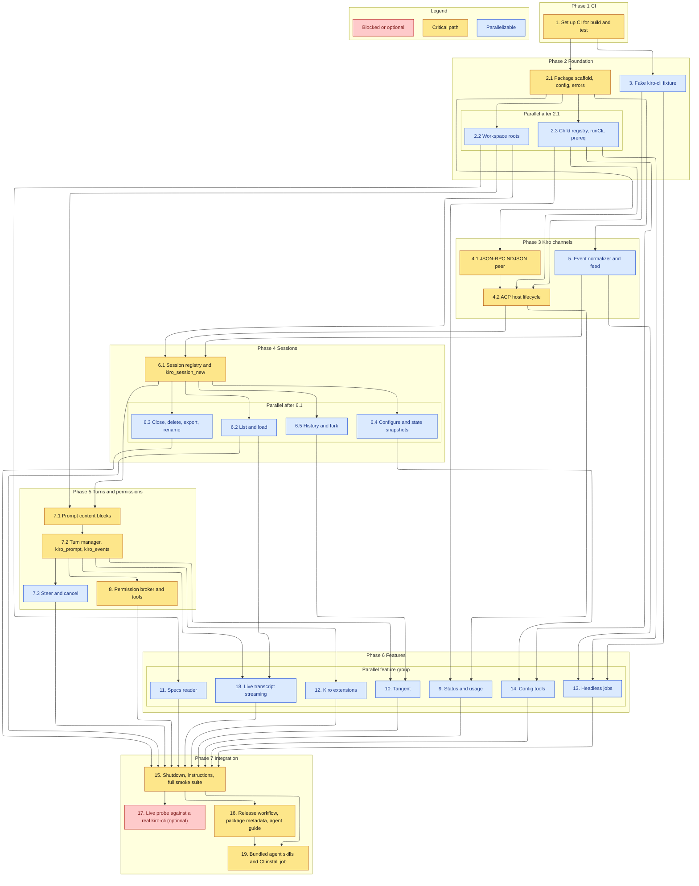

# Implementation Plan

This plan builds `kiro-mcp-server` from an empty repository to a publishable package: an ACP v3 host, 32 typed tools and a subscribable transcript resource, headless jobs, bundled agent skills, and the fake-CLI test suite. Each task ends with `npm run build` and `npm test` passing.

## Task graph

An arrow means depends-on. Primary critical path: 1, 2.1, 4.1, 4.2, 6.1, 7.1, 7.2, 8, 15, 16, 19.

Waves, computed from the arrows:

| Wave | Tasks |
| --- | --- |
| 1 | 1 |
| 2 | 2.1, 3 |
| 3 | 2.2, 2.3, 4.1, 5 |
| 4 | 4.2, 11, 13 |
| 5 | 6.1, 9 |
| 6 | 6.2, 6.3, 6.4, 6.5, 7.1 |
| 7 | 7.2, 14 |
| 8 | 7.3, 8, 10, 12, 18 |
| 9 | 15 |
| 10 | 16, 17 (optional) |
| 11 | 19 |

Three chains tie for longest: through 8, through 10, and through 18. The critical path shown goes through 8 because the permission flow is the core state change for orchestration.

## Tasks

- [x] 1. Set up CI for build and test
  - Create `.github/workflows/ci.yml` modeled on the sibling repo: on `push` and `pull_request`, `permissions: contents: read`, `ubuntu-latest`, `actions/checkout`, `actions/setup-node` with Node 22 and the npm cache, then `npm ci`, `npm run build`, `npm test`
  - There is no lint script. `npm run build` (strict `tsc`) is the static check, as in the sibling
  - Tests run only against `test/fixtures/fake-kiro.mjs`. The workflow installs no `kiro-cli` and sets no secrets
  - Gates every later task: it must pass before task 2.1 starts

- [x] 2. Foundation
- [x] 2.1 Package scaffold, config, and error model
  - Add the following:
    - `package.json`: name `@sohampatwardhan/kiro-mcp-server`, bin `kiro-mcp-server` pointing to `dist/src/index.js` (no leading `./`), `type: module`, `engines.node >=20`, `files`, `publishConfig.access public`, and the `build`, `prepack`, `start`, and `test` scripts;
    - `package-lock.json`;
    - `tsconfig.json` copied from the sibling (strict, `noUncheckedIndexedAccess`, `noImplicitOverride`, NodeNext);
    - `.gitignore`.
  - Dependencies: `@modelcontextprotocol/sdk` and `zod` only. Dev: `typescript`, `@types/node`. Check the current `McpServer` and `registerTool` API with Context7 or the installed `.d.ts` before writing against it
  - `src/config.ts`: parse and validate every variable in the design's configuration table and the fixed limits. Throw `ConfigError` naming the variable
  - `src/errors.ts`: the `ErrorCode` union, `ToolError`, and `toolErrorResult()`, which produces `{ error: { code, message, details } }`
  - `src/index.ts`: load config, exit 2 on `ConfigError`, connect `StdioServerTransport`, log only to stderr
  - `src/server.ts`: `createServer()` skeleton that registers tools from `src/tools/*` with strict schemas and an `outputSchema` each
  - Tests: `test/argv-config.test.ts` config cases (invalid values, booleans, defaults)
  - _Requirements: 1.1, 1.2, 25.1, 25.2, 25.3_

- [x] 2.2 Workspace roots
  - `src/paths.ts`: `Roots.fromConfig()` (real paths, `/` refused, must be directories) and `resolveInside(path)` with `realpath` and a separator-aware prefix check. It throws `PATH_OUTSIDE_ROOTS`
  - Tests: `test/paths.test.ts`, covering symlinks into and out of a root, a sibling that shares a name prefix, a missing path, and `/tmp` vs `/private/tmp` on macOS
  - _Requirements: 4.1, 4.2, 4.3, 4.4, 4.5_

- [x] 2.3 Child registry, CLI runner, and prerequisites
  - `src/children.ts`, ported from the sibling's design: `detached: true` spawns, a `track()` registry, `killGroup` (SIGTERM, then SIGKILL 5 s later), `Scope` cancel through `AsyncLocalStorage`, and `stopAll`
  - `src/cli.ts` `runCli(argv, opts)`:
    - `spawn` with `shell: false` and stdin closed, or stdin data when given;
    - the `KIRO_MCP_CLI_TIMEOUT_MS` timeout;
    - a 4 MiB output cap;
    - `cleanTerminalText` on returned text;
    - `TIMEOUT` and `CLI_EXIT` errors.
  - `src/prereq.ts`: resolve `KIRO_BIN` on `PATH`, read `--version`, build the `CLI_NOT_FOUND` message with the install command, and print the startup warning on stderr
  - `src/argv.ts`: `subcommandArgv()` for `whoami`, `profile`, `diagnostic`, `doctor --all`, `settings`, `agent`, `mcp`, `powers`, and `chat --list-models`, in a fixed order with `--flag=value`
  - Tests: `test/children.test.ts` (real `node` children including a grandchild) and the argv cases in `test/argv-config.test.ts`
  - _Requirements: 1.3, 24.1, 24.2, 24.4, 24.5_

- [x] 3. Fake kiro-cli fixture
  - `test/fixtures/fake-kiro.mjs`, not compiled. Dispatch on argv:
    - `acp` speaks NDJSON JSON-RPC with the probed `initialize` capability shape and the session methods and `_kiro/*` methods listed in the design's Testing Strategy;
    - `chat --v3 --no-interactive --output-format=stream-json` reads stdin and writes `runStarted`, `sessionUpdate`, and `runFinished`;
    - plus each subcommand the server calls.
  - Scenarios through `FAKE_KIRO_SCENARIO` and related `FAKE_KIRO_*` variables:
    - plain turn;
    - permission request with a `shell` and a non-shell capability;
    - long turn;
    - rate limit;
    - method-not-found;
    - crash mid-turn;
    - oversized and invalid lines;
    - unknown update;
    - signed out;
    - headless exits 0, 3, and 4, or a hang.
  - A meta log, path in `FAKE_KIRO_META`, records argv, every received request, and the pid
  - Rejects `--agent`, `--model`, `--effort`, and `--trust-*` on `acp`, as the real CLI does
  - _Requirements: 1.6_

- [x] 4. ACP channel
- [x] 4.1 JSON-RPC NDJSON peer
  - `src/acp/jsonrpc.ts` `JsonRpcPeer`:
    - line framing over a readable and writable pair;
    - `request` with ids and a per-request timeout;
    - `notify`;
    - `onRequest` and `onNotification` handlers;
    - an automatic `-32601` answer for unhandled agent-to-client requests;
    - `MAX_LINE_BYTES` drop and an invalid-JSON drop, both counted in `droppedLines`;
    - rejecting all pending requests on close.
  - Tests: `test/jsonrpc.test.ts`, with framing split at every chunk boundary
  - _Requirements: 5.3, 5.7_

- [x] 4.2 ACP host lifecycle
  - `src/acp/host.ts` `AcpHost`:
    - lazy `ensureStarted()` spawns `acpArgv()` (`assertAcp` refuses v2 flags) through the child registry, with the first root as `cwd`;
    - registers handlers before `initialize`, then stores capabilities;
    - `supports(method)` checks the advertised `extensionMethods` plus `KNOWN_UNADVERTISED`;
    - `call()` maps method-not-found to `UNSUPPORTED_BY_KIRO`, auth errors to `CLI_NOT_SIGNED_IN`, and other errors to `KIRO_ERROR` with `details.kiro` (no prompt text);
    - initialize failure becomes `ENGINE_V3_UNAVAILABLE`;
    - on exit: emits `hostExited`, bumps `generation`, and restarts on the next call after a short backoff.
  - `src/acp/types.ts`: the payload types the server reads
  - Tests: `test/host.test.ts` against the fake. Cover the start argv, capability storage, method gating, a crash that emits `hostExited`, a restart, and init failure
  - _Requirements: 1.4, 5.1, 5.2, 5.4, 5.5, 25.4_

- [x] 5. Event normalizer and feed
  - `src/events.ts`:
    - `normalizeUpdate()` for every update kind in the design's probe list, with chunk coalescing per turn segment, a tool-call merge by `toolCallId` (title never used for identity), `failureReason`, replay marking, and `unknown` for anything else;
    - `EventFeed`: a ring buffer with event and byte caps, `lowestCursor`, `read(cursor, limit)`, and `waitFor(cursor, ms, signal)`.
  - Typed state events for plan, mode, config, commands, context usage, steering, workflow, rate limit, and model fallback
  - Tests: `test/events.test.ts`, with fixtures copied from the probe shapes
  - _Requirements: 10.1, 10.2, 10.3, 10.5, 10.7, 10.8_

- [x] 6. Sessions
- [x] 6.1 Session registry and kiro_session_new
  - `src/sessions.ts`: `SessionRegistry` and `AttachedSession` (modes, config options, commands, snapshots, feed, user message refs). It routes notifications by `sessionId`. `detachAll` runs on `hostExited`. `ensureAttached()` re-attaches with `session/load` (resending `cwd` and `additionalDirectories`) when `hostGeneration` is stale, and never resends a prompt
  - `src/tools/sessions.ts` `kiro_session_new`:
    - checks roots;
    - sends `mcpServers: []` always;
    - sends `_meta.kiro` `modeId`, `modelId`, and `effortLevel`;
    - renames through `_kiro/session/rename` when `title` is given;
    - reports warnings for values Kiro did not apply;
    - `execution_target: "cloud"` requires an advertised `cloud-sandbox` and sends `executionTarget` with validated `repos`.
  - Tests: smoke cases for local and cloud new, unsupported cloud, `PATH_OUTSIDE_ROOTS`, and re-attach after a fake crash
  - _Requirements: 5.6, 6.1, 6.2, 6.3, 6.4, 6.5, 21.1, 21.2_

- [x] 6.2 kiro_session_list and kiro_session_load
  - `kiro_session_list`: scope, cwd (real path), source, `title_contains`, and limit filters, plus `omitted_count`. In user scope, hide local sessions outside the roots
  - `kiro_session_load`:
    - registers the handler before `session/load`;
    - keeps the replay in the feed with `replay: true` and returns a replay summary;
    - `latest: true` picks the newest session for a `cwd`;
    - remote sessions never get `noReplay`;
    - returns pending permissions that arrive on attach;
    - an unknown id gives `SESSION_NOT_FOUND`.
  - Tests: smoke cases for list filtering, load with replay, latest, remote load, and an unknown id
  - _Requirements: 4.5, 7.1, 7.2, 7.3, 7.4, 7.5, 7.6, 7.7, 21.4, 21.5_

- [x] 6.3 Close, delete, export, and rename
  - `kiro_session_close`: cancel, reject pending permissions, `session/close`, and return the final cursor. The closed session's feed stays read-only for the job TTL (up to 50 closed sessions) for streams to drain. `kiro_session_delete`: requires `confirm: true` and a root check for local sessions. `kiro_session_export`: destination inside a root, `PATH_EXISTS` unless `overwrite`. `title` on `kiro_session_configure` calls `_kiro/session/rename`
  - Tests: smoke cases for each tool, including `CONFIRMATION_REQUIRED` and `PATH_EXISTS`
  - _Requirements: 8.1, 8.2, 8.3, 8.4, 8.5, 8.6, 8.7_

- [x] 6.4 Configure and state snapshots
  - `kiro_session_configure`:
    - checks `mode`, `model`, `effort` (`effortLevel`), and `options` against the latest advertised modes and config options, then calls `session/set_mode` or `session/set_config_option`;
    - `VALUE_NOT_ADVERTISED` lists the allowed values;
    - returns Kiro's post-change config options.
  - Snapshot caching for `_kiro/mcp/status`, `tools/didChange`, `steering/documents_changed`, `progressive_context/items_changed`, `powers/items_changed`, `governance/state`, `customAgent/*`, and context usage. Each replaces the previous one
  - `kiro_session_state`:
    - includes the snapshot kinds;
    - `configuration` calls `_kiro/configuration/getState` with `observer: "session"`;
    - `context` calls `_kiro/session/context`;
    - `models` without a session runs `chat --list-models --format json`;
    - large fields are omitted unless `verbose`;
    - missing snapshots come back as `received: false`.
  - Tests: smoke cases for Spec, Plan, and Autonomous mode switches, an invalid value, and every snapshot kind
  - _Requirements: 13.1, 13.2, 13.3, 13.4, 13.5, 13.6, 14.1, 15.1, 15.2, 15.3, 15.4, 15.5, 17.1, 17.4_

- [x] 6.5 History and fork
  - Record `user_message_id_assigned` refs with the turn index and a preview. `kiro_session_history` pages `_kiro/session/history`, falls back to the feed, and lists rewind points. `kiro_session_fork` calls `session/fork` with an optional `_meta.kiro.messageId` and attaches the new session
  - Tests: smoke cases for history paging and fallback, and fork at a message id
  - _Requirements: 10.10, 16.1, 16.2_

- [x] 7. Turns
- [x] 7.1 Prompt content blocks
  - `src/prompt.ts` `buildPromptBlocks()`:
    - text;
    - files as `resource_link`, or embedded UTF-8 text under the embed cap;
    - images from a path or base64, limited to PNG, JPEG, GIF, and WebP under the cap, and refused when `promptCapabilities.image` is false;
    - `command` checked against the session's command catalog (`VALUE_NOT_ADVERTISED` with the closest names), sent as `/<name> <input>`;
    - `@name` text passed through unchanged.
  - Tests: `test/prompt.test.ts`
  - _Requirements: 9.2, 9.3, 9.4, 9.5, 9.8_

- [x] 7.2 Turn manager, kiro_prompt, and kiro_events
  - `src/turns.ts` `TurnManager`:
    - starts `session/prompt` and holds the turn;
    - settles only from the prompt response, with stop reason, final text, tool-call summary, credits from `turn_completion`, and elapsed time;
    - `when_busy` `reject` gives `TURN_ACTIVE`; `queue` holds up to the queue cap and starts the next prompt when the response arrives;
    - fails running turns with `HOST_EXITED` on host exit.
  - `kiro_prompt` waits up to `wait_s` and returns the result or a running status with the cursor. An MCP request cancellation stops the wait only. Send MCP progress notifications when a `progressToken` is present
  - `kiro_events` reads a session or job feed after a cursor, with `limit`, long-poll `wait_s`, `include_thoughts`, the turn status, and pending permissions
  - Tests: smoke cases for prompt-then-poll on a long turn, queueing, `TURN_ACTIVE`, progress notifications, client cancel, and host crash mid-turn
  - _Requirements: 3.2, 9.1, 9.6, 9.7, 10.4, 10.6, 10.9, 11.5_

- [x] 7.3 Steer and cancel
  - `kiro_steer`: `_session/steer` only during a running turn (otherwise `NO_ACTIVE_TURN`), and records the steering events. `kiro_cancel` for a session: answer pending permissions with the offered `reject_once` option (or cancelled), send `session/cancel`, and wait up to the cancel settle time for the prompt response
  - Tests: smoke cases for steer during a long turn, steer when idle, and cancel with a pending permission
  - _Requirements: 11.1, 11.2, 11.3_

- [x] 8. Permission broker and tools
  - `src/permissions.ts` `PermissionBroker`:
    - records pending requests with options, consent, and untrusted MCP identity;
    - applies `KIRO_MCP_PERMISSIONS` (`ask`, `deny`, `allow`), the shell gate (`KIRO_MCP_ALLOW_SHELL`, consent capability `shell` or tool kind `execute`), and the timeout auto-reject;
    - never synthesizes an option;
    - `allow_always` needs `KIRO_MCP_ALLOW_PERSISTENT_CONSENT`, with an optional `scope` and resource sent as `_meta.kiro.consent`;
    - a denial stays distinct from a cancellation;
    - `elicit()`: when the client declared elicitation (`getClientCapabilities()`), a pending `ask` request is also sent with `server.server.elicitInput` as a form with one enum field of the acceptable option ids. `accept` answers with that option, `decline` with `reject_once`, and `cancel` or an error leaves it pending.
  - `src/tools/permissions.ts`: `kiro_permissions` and `kiro_permission_respond` (`OPTION_NOT_OFFERED`, `PERMISSION_NOT_FOUND`, `PERSISTENT_CONSENT_DISABLED`, `SHELL_APPROVAL_DISABLED`)
  - Tests: `test/permissions.test.ts` (the policy matrix, with an injected clock for the timeout) and smoke cases for respond allow, respond reject, the shell gate, the timeout, and elicitation accept, decline, and cancel through a client that declares the capability
  - _Requirements: 12.1, 12.2, 12.3, 12.4, 12.5, 12.6, 12.7, 12.8, 12.9, 12.10, 12.11_

- [x] 9. Status and usage
  - `src/tools/status.ts`:
    - `kiro_status` returns the CLI path and version, the engine V3 init result, capabilities, roots, policy, log paths, and dropped-line count, plus `whoami --format json` and `profile` (only `accountType`, `email`, and the profile name). When signed out it returns the sign-in instruction. `include_diagnostics` adds `diagnostic --format json` and `doctor --all`;
    - `kiro_usage` calls `_kiro/account/getUsage` and adds per-session credit totals. `UNSUPPORTED_BY_KIRO` still returns the session totals.
  - Shared sign-in error mapping, so any tool reports `CLI_NOT_SIGNED_IN`
  - `src/trust.ts` `workspaceTrust()` (design Decision 9): `kiro_status` reports `trusted` per root and a warning with the `kiro-cli --v3` instruction for each untrusted root. Read-only
  - `src/parse.ts`: whoami and profile parsing
  - Tests: `test/parse.test.ts`, `test/trust.test.ts`, and smoke cases for signed in, signed out, diagnostics, usage, unsupported usage, and an untrusted root (fake `HOME`)
  - _Requirements: 2.1, 2.2, 2.3, 2.4, 2.5, 2.6, 3.1, 3.3, 3.4_

- [x] 10. Tangent
  - `src/tangent.ts` `TangentTree` and `src/tools/branching.ts` `kiro_tangent`:
    - `branch` forks at the latest message and names the fork, or uses `tangent-N`. A session with no messages gives `NOTHING_TO_BRANCH`;
    - `tree` returns the recorded tree;
    - `merge` sends one summary prompt in the tangent, then one prompt in the destination (`parent`, `root`, or a name). Errors are `TANGENT_NOT_FOUND` and `INVALID_MERGE_TARGET`;
    - the output notes that the tree is held in memory.
  - Tests: `test/tangent.test.ts` and a smoke case for branch, merge, and tree
  - _Requirements: 16.3, 16.4, 16.5, 16.6, 16.7, 16.8_

- [x] 11. Specs reader
  - `src/specs.ts` and `src/tools/specs.ts` `kiro_specs`:
    - `list` shows the folders under `cwd/.kiro/specs` with which documents exist, their modification times, and checked and unchecked task counts;
    - `read` returns a document up to the read cap, with parsed tasks for `tasks.md`;
    - a missing spec or document gives `SPEC_NOT_FOUND`;
    - `cwd` must be inside a root.
  - Tests: the tasks parse cases in `test/parse.test.ts` and a smoke case against a temp spec folder
  - _Requirements: 14.2, 14.3, 14.4_

- [x] 12. Kiro extensions
  - `src/tools/extensions.ts`:
    - `kiro_session_compact` (`_kiro/session/compact`; `TURN_ACTIVE` while a turn runs);
    - `kiro_memory`: list, get, create, update, delete (with `confirm`), and `sync_status` from the cached `_kiro/memory/syncStatus`;
    - `kiro_knowledge`, with typed subcommands and add paths inside a root;
    - `kiro_code_intelligence`;
    - `kiro_workflow`: `list_recipes`, `list`, `invoke` with inputs checked against the recipe's input names, `inspect`, `pause`, `resume`, `cancel`, `retry`, and `delete`, plus workflow lifecycle events in the feed;
    - `kiro_cloud_sources`: `_kiro/sourceProviders/list` and `listResources`.
  - Kiro `success: false` gives `KIRO_REFUSED`
  - Tests: smoke cases for each tool against the fake, including refused, unsupported, and a confirm-required delete
  - _Requirements: 17.2, 17.3, 18.1, 18.2, 18.3, 18.4, 19.1, 19.2, 19.3, 19.4, 20.1, 20.2, 20.3, 20.4, 20.5, 21.3_

- [ ] 13. Headless jobs
  - `src/argv.ts`:
    - `headlessArgv()` builds the fixed order from the design;
    - `assertHeadless()` refuses a positional prompt;
    - `trust_all_tools`, `trust_tools`, and `trust_workspace` are gated by `KIRO_MCP_HEADLESS_TRUST` and `KIRO_MCP_ALLOW_TRUST_WORKSPACE` (`HEADLESS_TRUST_DISABLED`).
  - `src/jobs.ts` `JobStore`: ids, status, TTL and cap, `settleWithin`. `src/headless.ts` `runHeadlessJob()`:
    - `cwd` inside a root;
    - prompt on stdin;
    - per-child `KIRO_HEADLESS_WORKFLOW_TIMEOUT_SECS`;
    - inherited `KIRO_API_KEY`, never readable or settable by input;
    - stream-json lines through `normalizeUpdate` into the job feed;
    - `runFinished` fields and the interruption record;
    - the exit code and its meaning, plus a stderr tail;
    - the timeout, and cancel through the process group.
  - `src/tools/headless.ts` `kiro_run_headless`. `kiro_events` and `kiro_cancel` accept `job_id`
  - Tests: `test/jobs.test.ts`, argv cases, and smoke cases for success, exit 3, exit 4, the trust gates, cancel, the timeout, and cloud flags
  - _Requirements: 11.4, 22.1, 22.2, 22.3, 22.4, 22.5, 22.6, 22.7, 22.8_

- [ ] 14. Config tools
  - `src/tools/config.ts`:
    - `kiro_agents`: `list` from ACP modes and config errors, `validate`, and the gated `create`, `set_default`, and `upgrade`;
    - `kiro_mcp_config`: `list` and `status` with text parsing in `src/parse.ts`, and the gated `add` (HTTP URL only; a command server gives `STDIO_SERVER_WITHHELD`) and `remove`;
    - `kiro_settings`: `list` and `get` through `settings list --format json`, and the gated `set` and `delete` with the key pattern and `SETTING_WITHHELD` keys;
    - `kiro_powers`: `list` from the snapshot, and the gated `install` (a catalog name or a path inside a root) and `uninstall`.
  - Every write fails with `CONFIG_WRITES_DISABLED` unless `KIRO_MCP_ALLOW_CONFIG_WRITES` is set, and its result notes when the change applies
  - Tests: parse cases and smoke cases for each read, each write gated off and on, and the withheld cases
  - _Requirements: 23.1, 23.2, 23.3, 23.4, 23.5, 23.6, 23.7, 23.8, 23.9_

- [ ] 15. Shutdown, server instructions, and full smoke suite
  - `src/index.ts`: on stdin close, SIGINT, SIGTERM, or SIGHUP, cancel running turns, close the host's stdin, run `stopAll`, and exit
  - `SERVER_INSTRUCTIONS` in `src/server.ts` with the content listed in the design. That includes composing `/spec run`, `/goal`, `/clear`, and `/spawn`, and the impossible features with their reasons
  - Assert in `test/smoke.test.ts` that:
    - the tool list exactly matches the 32-tool table;
    - every tool has an `outputSchema`;
    - unknown properties are rejected;
    - no tool or field forwards free-form flags or raw ACP methods;
    - error bodies have the documented shape with no prompt text in `details.kiro`;
    - no token or `KIRO_API_KEY` value appears in any output;
    - shutdown stops the fake host and a running headless child (checked with the meta-log pids).
  - _Requirements: 1.1, 14.5, 20.6, 24.3, 24.6, 24.7, 25.5_

- [ ] 16. Release workflow, package metadata, and agent guide
  - `.github/workflows/release.yml` copied from the sibling:
    - `v*.*.*` tag or `workflow_dispatch`;
    - the tag must match the `package.json` version;
    - Node 24, npm 11.5.1 or later, then `npm ci`, build, and test;
    - `npm publish --provenance --access public` through trusted publishing (OIDC, no `NPM_TOKEN`);
    - `gh release create`;
    - the GitHub Packages mirror job.
  - `AGENTS.md` (the agent guide: tool table, architecture, safety rules, test layout) and `CLAUDE.md` (`@AGENTS.md`). Also `README.md` with install through `npx -y @sohampatwardhan/kiro-mcp-server@latest`, client config examples, the tool and environment tables, the error table, and a credit to `vanphappi/kiro-cli-mcp` as inspiration. The README also says to trust each root once in `kiro-cli --v3` and documents the `KIRO_MCP_ALLOW_SHELL` opt-in (design Decisions 9 and 14). `.mcp.json` registers Context7 for library docs, as in the sibling
  - Tests: a `test/smoke.test.ts` case that the packed `package.json` bin path and `files` list resolve (`npm pack --dry-run --json`)
  - _Requirements: 1.5_

- [ ] 17. Live probe against a real kiro-cli (optional)
  - `scripts/live-probe.mjs` and `npm run probe:live`, run by hand only, never in CI:
    - requires `KIRO_MCP_LIVE=1`;
    - creates a scratch workspace, runs `initialize`, `session/new`, a one-line prompt with the cheapest model, and a rejected shell permission;
    - compares the shapes with the fake fixture;
    - deletes the sessions it created.
  - _Requirements: 1.6_

- [ ] 18. Live transcript streaming
  - `src/transcript.ts`: `readStream()` over a session feed with the `types` filter (the cursor still advances past skipped events), `max_chars` truncation that resumes at the first event left out, `gap` when the cursor is below `lowestCursor`, and thought omission. `TranscriptNotifier` keeps subscribed URIs and coalesces `notifications/resources/updated` per URI on a 250 ms timer
  - `src/tools/stream.ts`:
    - `kiro_stream_session` with the short default `wait_s`, auto-attach through the same path as `kiro_session_load` when the session is not attached, and `session_state` (`attached` or `closed`) plus the turn status;
    - the `kiro-session://{session_id}/transcript` resource template, with list, read capped at the resource cap, and auto-attach;
    - `SubscribeRequestSchema` and `UnsubscribeRequestSchema` handlers on the low-level server, and a feed append hook that calls `TranscriptNotifier.touched()`.
  - Tests: `test/transcript.test.ts` and smoke cases for streaming a session loaded from the store (replay first), idempotent cursor reads, a cancelled turn, a closed session, the resource read, and a subscribed client receiving `notifications/resources/updated` within 1 s
  - _Requirements: 26.1, 26.2, 26.3, 26.4, 26.5, 26.6, 26.7_

- [ ] 19. Bundled agent skills and CI install job
  - `skills/kiro-orchestration/SKILL.md` with `name`, `description`, and `metadata` (`author: Soham Patwardhan`, `version: "1.0.0"`), plus `references/` for the tool cheat sheet and recovery playbook. Covers delegating a task, choosing mode, model, effort, and permissions (including the `KIRO_MCP_ALLOW_SHELL` opt-in), following a run with `kiro_stream_session` or the transcript resource, collecting results and patches, and recovery
  - `scripts/check-skill-versions.mjs` copied from `KaTeX-Agent-Skill`
  - Extend `.github/workflows/ci.yml` with a `skills` job: the version check, then `npx -y skills add "$GITHUB_WORKSPACE" -g -y -a claude-code -a codex --json` with a throwaway `HOME` and `CI=true`, a `jq` check that every entry is `installed`, and a loop that checks each `skills/*/SKILL.md` exists under `$HOME/.agents/skills/`
  - README **Install the skills** section with `npx skills add sohampatwardhan/kiro-mcp-server -g`, a `--skill kiro-orchestration` example, and an `-a <agent>` example
  - Tests: the CI job itself, run locally once with the same commands before pushing
  - _Requirements: 27.1, 27.2, 27.3, 27.4, 27.5_
