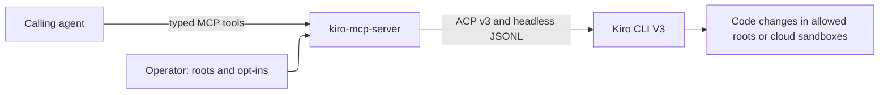

# Product

## Purpose

`kiro-mcp-server` (npm `@sohampatwardhan/kiro-mcp-server`, bin `kiro-mcp-server`) is an MCP stdio server. It lets AI agents orchestrate Kiro CLI V3 coding sessions through typed tools instead of shell commands. Examples of such agents: Grok Bot, Claude, Cursor, Codex, and other MCP clients with an always-on computer. It is the Kiro sibling of `claude-code-mcp-server`.

## Users

- **Calling agents** create, prompt, steer, and inspect Kiro sessions, and answer Kiro's permission requests.
- **Operators** install the server next to a signed-in `kiro-cli`. They choose which directories Kiro may run in and which trust and config-write powers the calling agent gets.

## Key features

- Kiro CLI V3 feature parity through the V3 ACP server: sessions, prompts with file and image context, streaming events, modes (including Spec), model and effort, permissions, snapshots, tangent and rewind, compaction, memory, knowledge, code intelligence, workflows, cloud sessions, and usage.
- Headless JSON Lines runs for fire-and-forget and CI-style work.
- A feature-parity matrix that records what is exposed, composed, gated, withheld, or impossible, and why.

## Objectives

- No escape hatch: there is no shell tool, no raw argv, and no generic ACP passthrough.
- Safe defaults. The operator opts in to shell approvals, persistent consent, headless trust, and config writes.
- Parity is tracked in `.kiro/specs/kiro-v3-orchestration/requirements.md`. A new Kiro capability is added there before it gets code.

