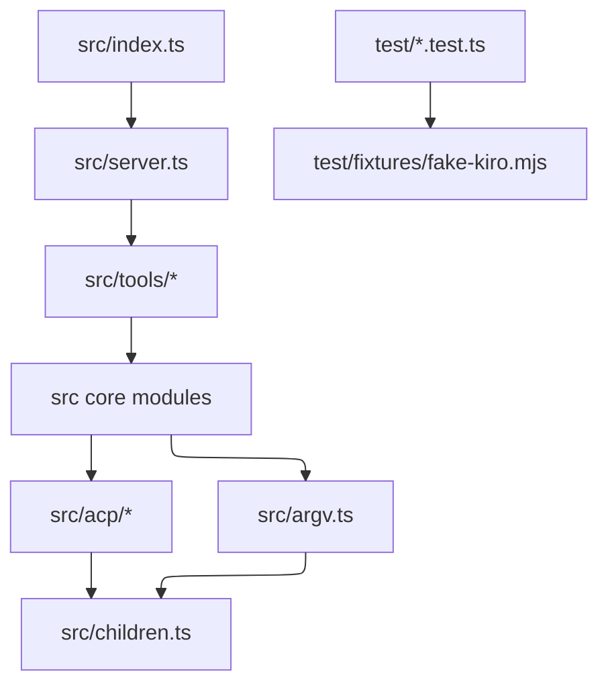

# Structure

## Directories

| Path | Owns |
| --- | --- |
| `src/index.ts` | Entry point, config load, stdio transport, shutdown |
| `src/server.ts` | `createServer` composition root and `SERVER_INSTRUCTIONS` |
| `src/tools/` | One file per tool group. Each tool has a strict input schema, an `outputSchema`, and `structuredContent` |
| `src/acp/` | JSON-RPC peer, ACP host lifecycle, payload types |
| `src/argv.ts` | The only place `kiro-cli` argv is built |
| `src/` (other files) | Core modules: config, errors, paths, children, cli, prereq, parse, sessions, events, turns, permissions, prompt, tangent, specs, jobs, headless |
| `test/` | `node:test` suites, compiled with the sources |
| `test/fixtures/fake-kiro.mjs` | Stand-in `kiro-cli` (not compiled) |
| `.kiro/specs/` | Specs. `kiro-v3-orchestration` holds the parity matrix |
| `.github/workflows/` | `ci.yml` (build and test) and `release.yml` (trusted publishing) |

## Rules

- Tools call core modules. Core modules never import from `src/tools/`.
- Only `src/acp/host.ts` writes to the host process. Only `src/argv.ts` builds argv. Only `src/children.ts` signals processes.
- New error codes go in `ErrorCode` in `src/errors.ts` and in the README error table.
- A new tool needs a spec change, a row in the parity matrix, a strict schema, an `outputSchema`, and smoke coverage.
- Tests that cover a behavior live in the test file that owns that module (see the design's Testing Strategy).

