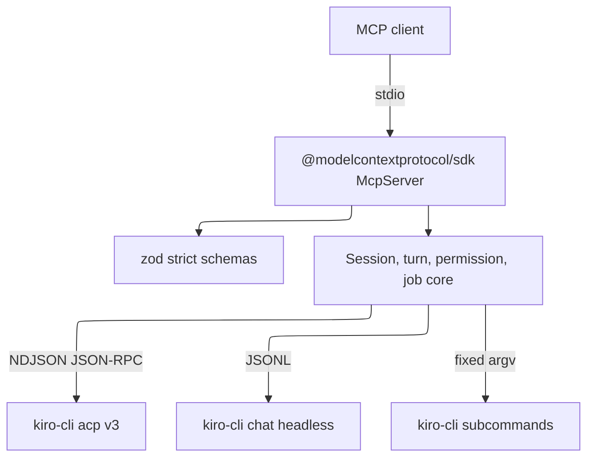

# Technology stack

## Runtime

- Node.js 20 or later, TypeScript 5 (`strict`, `noUncheckedIndexedAccess`, `noImplicitOverride`), ESM with `NodeNext` resolution and `.js` extensions on relative imports.
- Runtime dependencies: `@modelcontextprotocol/sdk` and `zod` only. Dev dependencies: `typescript` and `@types/node`.
- Build with `npm run build` (`tsc -p tsconfig.json`, emitting `dist/`). Test with `npm test`, which builds and then runs `node --test` on `dist/test/*.test.js`. There is no lint script. The typecheck is the static check.
- Style: double quotes, semicolons, trailing commas, 2-space indent, numeric separators (`120_000`).

## Integrations

- **Kiro CLI V3 ACP**: `kiro-cli acp --agent-engine=v3 --auth-method=cli`, newline-delimited JSON-RPC 2.0 over stdio. Never pass `--agent`, `--model`, `--effort`, or `--trust-*` to it. Gate optional `_kiro/*` methods on the advertised `extensionMethods` plus the documented `KNOWN_UNADVERTISED` list.
- **Kiro headless**: `kiro-cli chat --v3 --no-interactive --output-format=stream-json`, with the prompt on stdin.
- **Kiro CLI subcommands** with fixed argv: `whoami`, `profile`, `diagnostic`, `doctor --all`, `settings`, `agent`, `mcp`, `powers`, `chat --list-models`.
- Check library APIs, above all the MCP SDK (`McpServer`, `registerTool`, transports), against current docs through Context7 (`.mcp.json`) or the installed `.d.ts`. Do not rely on memory. Check Kiro behavior against https://kiro.dev/llms.txt and the installed CLI's `--help`.

## Constraints

- Tests never run a real `kiro-cli`. They use `test/fixtures/fake-kiro.mjs` through `KIRO_BIN`.
- All state is in memory. Never read or write Kiro's session files.
- Every child is spawned `detached: true`, `shell: false`, and tracked for process-group cleanup.
- No telemetry, and no tokens, API keys, or authorization URLs in output or logs.

Live reference:

```text
#[[file:.kiro/specs/kiro-v3-orchestration/design.md]]
```


